# Telepad

A small desktop infrastructure monitor written in Rust. Telepad logs in to your
hosts with the **system OpenSSH client** and the keys you already use, runs a
**read-only** POSIX shell script, and shows per host (everything in one window: a page
sidebar on the left, pages as windows inside Telepad that can be moved, resized,
minimized, maximized, tabbed and arranged, kept in named workspaces like MikroTik WinBox):

- OS name and logo, kernel, architecture, uptime
- CPU model, cores, usage %, load average
- Memory and swap capacity vs usage
- Disk capacity vs usage per mount
- Temperatures and fan speeds (hwmon/thermal; BMC via `ipmitool` on physical servers)
- IP addresses and listening ports
- Docker containers and compose stacks: image, state, container IP per network, published ports
- **Open SSH** (a terminal logged in to the host), **Copy ssh command**, and **Open RDP**
  for Windows hosts without SSH
- **My Computer**: the same page for the PC Telepad runs on (system, maintenance, usage,
  disks, network, sensors, Docker, ports), without SSH; **Open Terminal**, **Open files…**
  with this computer on both sides, and its local MariaDB / MySQL / PostgreSQL
- **Groups** and **Clusters**: optional, independent labels for your hosts (a host can be in
  group *Office* and cluster *Web*); each has a "Hosts - [name]" page like the Hosts page
- **Portainers**: register your Portainer servers (API token in the OS password store) and see
  each one's environments, stacks and containers through an SSH tunnel to its host; start,
  stop, delete and edit stacks (compose file and variables) and run container actions
- **Open files…**: a WinSCP-style file window per host, this computer on the left and the host
  on the right; upload / download with drag and drop, overwrite questions and progress,
  over SFTP (scp when the host has no SFTP server, rsync when both sides have it); new
  folder / file, rename, delete, properties and permissions on both sides; compare the two
  folders, synchronize them (preview first), diff two files side by side, transfer settings
  (text / binary, new and updated only, excluded folders); a VS Code-like
  editor (tabs, syntax colours, find / replace, line endings kept, changed-on-host check)
- **Authorized keys**: the keys in each host's `authorized_keys`, by server or by key,
  and add or revoke one SSH public key on many hosts at once; **My keys** lists the key
  pairs on this computer, generates new ones (`ssh-keygen`, Ed25519 by default) and converts
  them between OpenSSH, PuTTY `.ppk`, PEM, PKCS#8, PKCS#12, JWK, DER and OpenPGP (GPG)
- **Log info**: per host, who logged in over SSH, with which key, from where and when
  (the host's systemd journal, read without sudo; one table with sort, filters and pages),
  with a terminal to give the login user journal access (`systemd-journal`) or take it away
- **Host Management**: add, import (OpenSSH config, JSON, pasted text) and export hosts;
  Telepad's hosts next to `~/.ssh/config` (or another config file); copy, edit or delete
  per host, merge / replace / sync, with a preview and a backup before the file is written
- **Open database…**: a HeidiSQL-style window for MariaDB / MySQL / PostgreSQL in a
  container or on the host, through the SSH login (tree, data grid with editing, queries,
  table structure); passwords optionally in the system password store; a **SQL log** of
  everything that changed data or structure, like HeidiSQL
- **History** of every upload, download and file change per host, kept for 90 days
- **Remote Desktop settings** per host (screen, user, drives, gateway …) saved in Telepad,
  imported from / exported to `.rdp` files, used by **Open RDP**
- **Workspaces** bring back their file, editor and database windows, and ask before
  anything unsaved is thrown away; uploads and downloads keep running across workspaces

No agent is installed on the hosts, and monitoring never changes anything on them. The
only changes are actions you start and confirm yourself (Docker actions, BMC setup,
Authorized keys, database edits, file copies). There is no server
and no web UI: it is one portable desktop app plus a headless `telepad-check`.

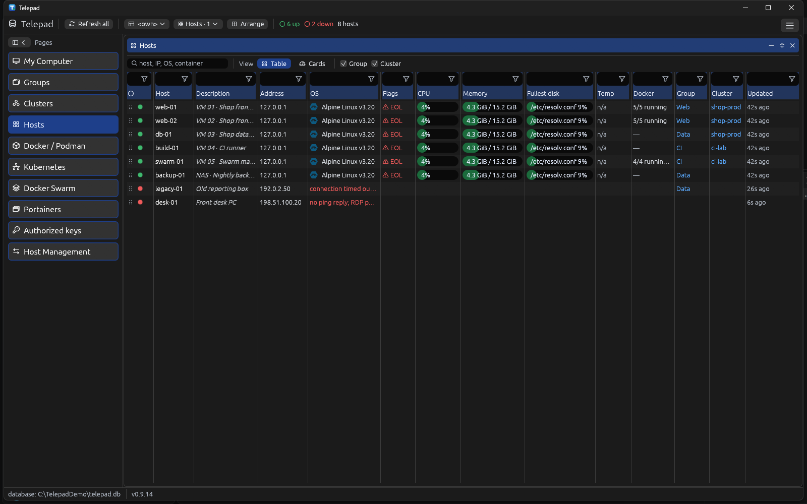

<sub>Screenshots use made-up host names and documentation addresses.</sub>

### How it works

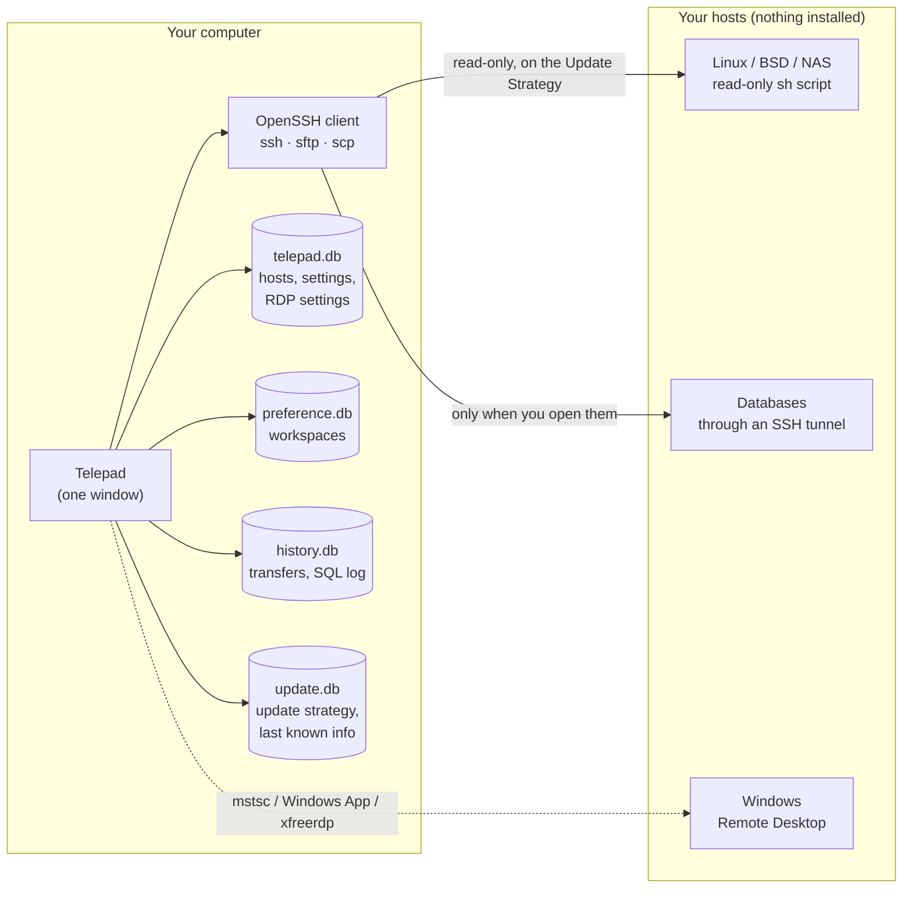

| Telepad … | … never |
|---|---|
| reads the hosts with your own `ssh` login and keys | installs an agent or changes a host while monitoring |
| changes something only after you saw it and confirmed (Docker action, key, SQL, file copy) | runs `sudo` in the background (only `sudo -n`, which never asks) |
| keeps its data in three files next to each other | sends anything anywhere except to your hosts and, for updates, GitHub |
| stores database passwords in the system password store, if you say so | stores a password in its own files |

Releases are built for Windows (x86_64), macOS (Apple silicon and Intel) and Linux
(x86_64 and ARM64). Windows is the first target; on macOS and Linux the desktop parts
(terminal launch, RDP) are less tested.

## Install

### Windows (installer)

1. Download `telepad-<version>-windows-x86_64-setup.exe` from
   [Releases](https://github.com/yohannaftali/telepad/releases) and run it. It installs for
   your user only (no administrator rights) to `%LOCALAPPDATA%\Programs\Telepad` and adds a
   Start-menu entry; uninstall it in **Settings → Apps**.
2. Start **Telepad** from the Start menu.

Your hosts and settings live in `%APPDATA%\Telepad\telepad.db` (workspaces in
`preference.db`, the update strategy and last known host info in `update.db` next to it),
and uninstalling keeps them. To import an existing OpenSSH config on the first start, put it there as `config`, or
use **Host Management → Import → From ~/.ssh/config**.

### Windows (portable zip)

1. Download `telepad-<version>-windows-x86_64.zip` from
   [Releases](https://github.com/yohannaftali/telepad/releases). Optionally compare it
   with the `.sha256` file next to it:
   `Get-FileHash telepad-*.zip -Algorithm SHA256`.
2. Unzip it anywhere you can write to, for example `C:\Tools\telepad\`.
3. Run `telepad.exe`.

Nothing is installed in the system; delete the folder to remove Telepad. Because of the
`portable` file in the zip, the database and generated ssh config are created next to the
exe, so the folder must be writable
(`Program Files` is not a good place).

Both are updated from inside the app ([Updates](docs/USER_MANUAL.md#updates)). Windows may
show a SmartScreen warning the first time because the files are not code-signed:
choose **More info → Run anyway**.

### macOS

1. Download `telepad-<version>-macos-aarch64.dmg` (Apple silicon) or
   `telepad-<version>-macos-x86_64.dmg` (Intel) from
   [Releases](https://github.com/yohannaftali/telepad/releases), open it and drag
   **Telepad** to **Applications**.
2. Telepad is not notarized by Apple, so the first start is blocked. Either right-click
   Telepad in Applications → **Open** → **Open**, or run once in Terminal:

   ```sh
   xattr -dr com.apple.quarantine /Applications/Telepad.app
   ```

3. Start Telepad from Applications or Launchpad. **Open SSH** uses Terminal.app.

Hosts and settings live in `~/Library/Application Support/Telepad/telepad.db` (workspaces
in `preference.db`, the update strategy in `update.db` next to it); put an
OpenSSH config there as `config` to import it on the first start, or use
**Host Management → Import → From ~/.ssh/config**. A portable zip (`telepad-<version>-macos-<arch>.zip`)
is also published; it keeps its data next to the program and needs the same `xattr` step
for its folder.

### Linux

1. Download `telepad-<version>-linux-x86_64.zip` or `telepad-<version>-linux-aarch64.zip`
   from [Releases](https://github.com/yohannaftali/telepad/releases) and unzip it somewhere
   you can write to, e.g. `~/.local/opt/`.
2. Start `./telepad`. It runs on X11 and Wayland; file dialogs use the XDG desktop portal
   (`xdg-desktop-portal`, present on GNOME and KDE desktops). **Open SSH** uses the first
   terminal it finds: `x-terminal-emulator`, `gnome-terminal`, `konsole`, `xfce4-terminal`,
   `alacritty`, `kitty` or `xterm`.

The Linux builds are made on Ubuntu 22.04 and need glibc 2.35 or newer.

On every platform the folder must stay writable: `telepad.db`, `preference.db`, `history.db` and
`update.db` are created next to the program, and in-app updates replace the programs in place.

### With Cargo (any platform)

```sh
cargo install --git https://github.com/yohannaftali/telepad --locked telepad-gui telepad-check
```

This builds and installs `telepad` and `telepad-check` into `~/.cargo/bin`. See
[Building from source](CONTRIBUTING.md#building-from-source) for the prerequisites. When installed this way,
pass `--db <path>` (or set `TELEPAD_DB`) so the database does not live in `~/.cargo/bin`
(`preference.db` and `update.db` go next to it; `--prefs <path>` / `TELEPAD_PREFS` and
`--update-db <path>` / `TELEPAD_UPDATE_DB` put them elsewhere),
and update with the same `cargo install` command instead of the in-app updater.

### Requirements on your PC

- The OpenSSH client: Windows 10/11 ship it at `C:\Windows\System32\OpenSSH\ssh.exe`
  (Settings → Optional features → *OpenSSH Client* if it is missing); macOS and Linux have `ssh`.
- **Key-based** SSH access to your hosts. Password logins are not supported: Telepad
  never shows a password prompt, it reports "authentication failed" instead.
- Windows Terminal is recommended for **Open SSH** (otherwise a console window opens).

### Requirements on the hosts

Nothing to install. The collection script uses POSIX `sh` and common tools
(`/proc`, `df`, `ip`/`ifconfig`, `ss`/`netstat`, `docker`), each guarded, so BusyBox
systems and NAS devices work and missing tools only hide that section.

## Quick start

1. Put your OpenSSH client config next to `telepad.exe` and name it `config`, or start
   with an empty list. A minimal entry:

   ```
   # Web server in rack 2          <- shown as the description
   Host web01
     HostName 192.0.2.10
     User admin
     IdentityFile ~/.ssh/id_ed25519
   ```

2. Start Telepad. On the first start the hosts from `config` are imported into
   `telepad.db`, and every host is checked once. No config? Open **Host Management** in
   the sidebar and use **Add host…** or **Import → From ~/.ssh/config**.
3. The **Hosts** page shows every host: status, OS, CPU, memory, disks, Docker. Click a
   row for the host's own window (details, sensors, ports, containers).
4. **Right-click** a host for its menu: **Open SSH** (a terminal logged in to it),
   **Files** (copy files to and from it, edit them), its databases, Edit, Clone, Delete.

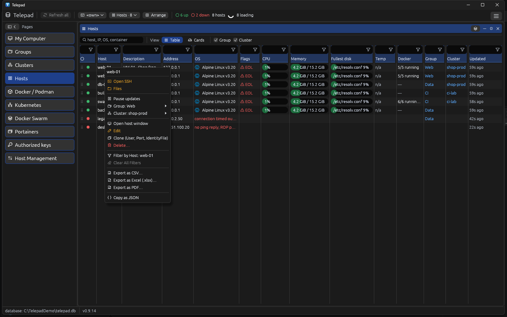

## Using Telepad

Telepad is one window. The **sidebar** on the left opens pages; each page opens as a window
**inside** Telepad that you can move (drag its title), resize (drag its right or bottom
edge), minimize (**−**, it waits in a strip at the bottom), maximize (corners out, or
double-click the title) and close (**×**). Put two pages in one window as tabs with the
**⧉** button; the **▯ ‹** button folds the sidebar to icons.

The **top bar** holds the tools for those windows:

- **Workspace** (`<own>` at first): saved sets of windows with their places, like MikroTik
  WinBox. **Add…** keeps the windows that are open now under a name, picking a workspace
  closes the current windows and opens its own, the trash icon deletes one, and `<none>`
  closes every window. Changes are saved automatically in `preference.db`.
- **Window picker**: the window in front and how many are open; click it for the list of
  every open window — type to search, Enter brings that window to the front.
- **Arrange**: **Tile** side by side, **Stack** as a cascade, **Minimize all**, **Restore all**.
- **☰**: **Settings → Theme** (System / Light / Dark), **Update Strategy…** (pause all hosts
  or single ones — also from a host's page or right-click menu — and which checks run
  by themselves and how often: ping 30 s, live metrics 1 min, addresses / ports / pending
  updates 6 h, OS info 1 day by default; saved in `update.db`, which also keeps each host's
  last known OS and updates so a restart shows them at once) and **Software update…**.

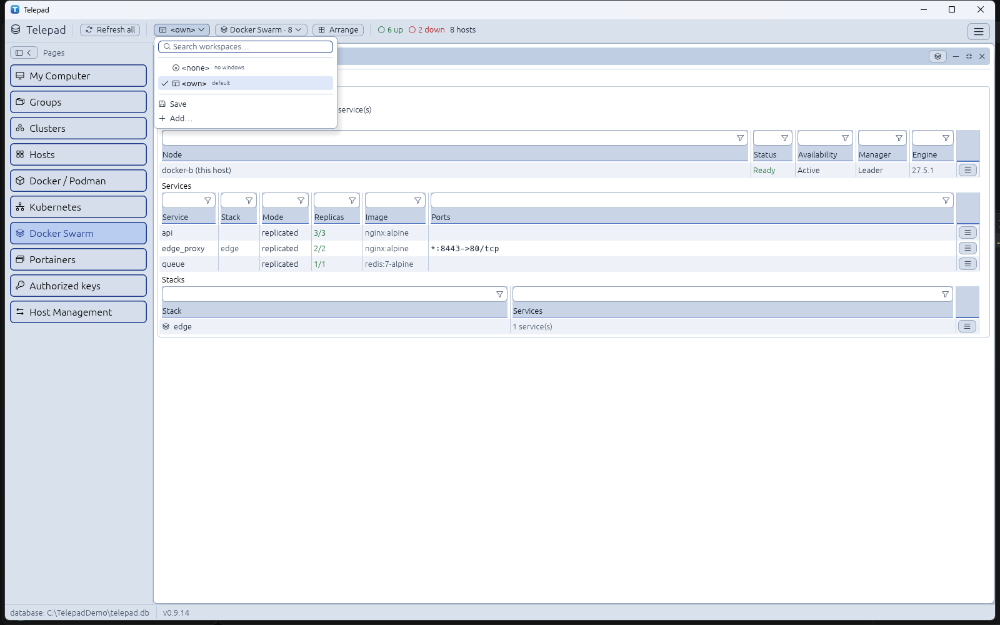

| Page | What you do there |
|---|---|
| **Groups**, **Clusters** | Your host groups and clusters (plus Ungrouped / No cluster): add, rename, describe, reorder, delete; click one for its "Hosts - [name]" page, **Add hosts…** to move hosts in |
| **Hosts** | All hosts as a table or cards. Search box at the top; click a header to sort; columns fit the page by themselves (drag a border to set a width, double-click it for automatic again). Group / Cluster columns (click one to open that group / cluster). Click a row to open the host, right-click for its menu (incl. Group / Cluster) |
| **Docker / Podman** | Every container of every host, grouped by compose stack, with start / stop / logs / shell actions (each one shown and confirmed in a terminal) |
| **Kubernetes**, **Docker Swarm** | The clusters found on your hosts: nodes, workloads, services, problems |
| **Portainers** | Your Portainer servers: add / edit / delete with an API token, status and version; click one for its environments, stacks and containers; start, stop, delete and edit stacks (compose file, variables, Update) and run container actions (the risky ones ask first) |
| **Authorized keys** | Who can log in with which SSH key: by server or by key, grouped by the `#` comment lines in `authorized_keys`. Add or revoke a key on many servers at once (you type `add` / `revoke` to confirm), or edit the file |
| **Host Management** | **Add host…**, **Import** (from a file, `~/.ssh/config` or pasted text) and **Export…**; compare Telepad's hosts with `~/.ssh/config` and copy, edit or delete hosts on either side |

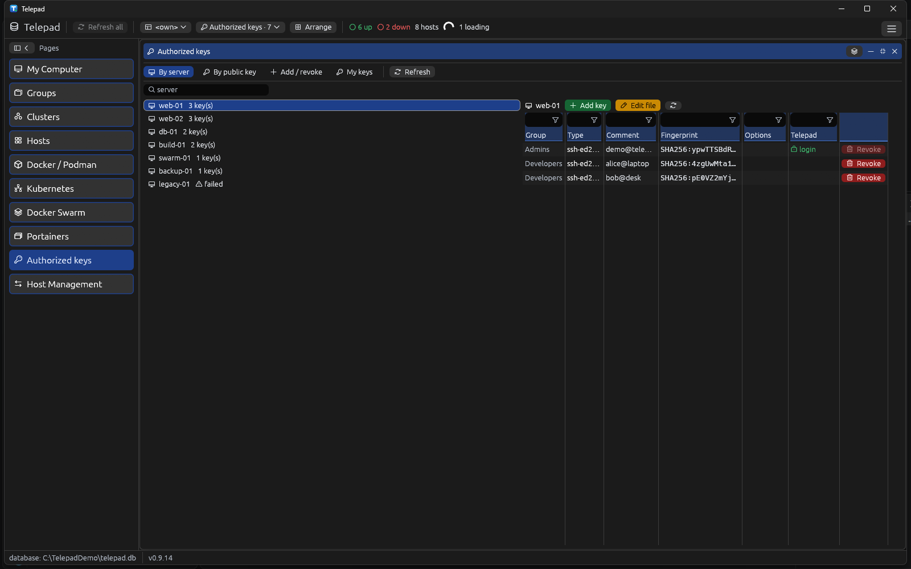

**Buttons tell you what they do by colour:** red deletes or revokes, yellow edits, green
adds, amber opens a session (SSH / RDP). **☰ → Settings → Theme** switches System / Light /
Dark:

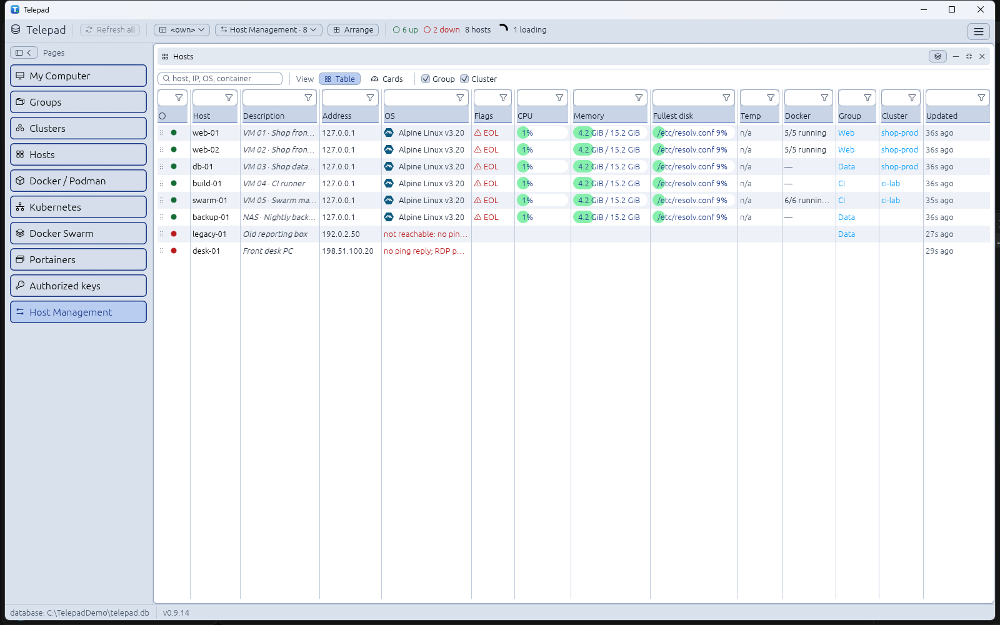

### A tour

**Groups and clusters.** Put hosts into groups (where they are, who owns them) and,
separately, clusters (what they serve together). Each one has a page with its own Hosts
table; click a host's group or cluster anywhere to open it.

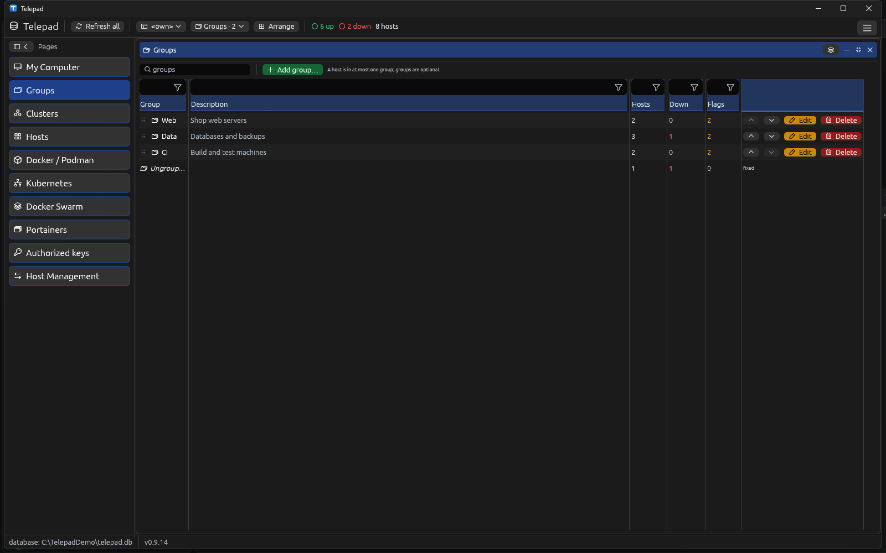

**Every table works the same way**: sort by a click on the title, a filter box above each
column (`>80%`, `=Data`, `!NULL`), a funnel that lists the column's values to pick one, and a
right-click menu with Filter by, exports (CSV, Excel, PDF) and Copy as JSON.

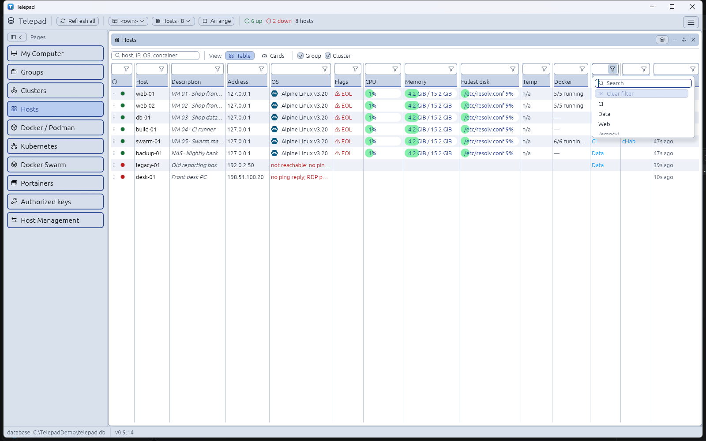

**The host page** has the system, maintenance flags (end-of-life OS, reboot, pending
updates), usage, disks, network, sensors, the Docker containers by stack — with each stack's
compose menu, or **Open stack** for a Portainer stack — and the ports in use with the
container behind each one.

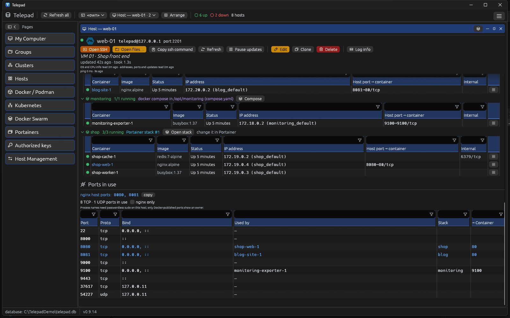

**Docker / Podman** collects the containers of every host by stack; **Docker Swarm** and
**Kubernetes** show the clusters found on your hosts with their nodes, services and
problems.

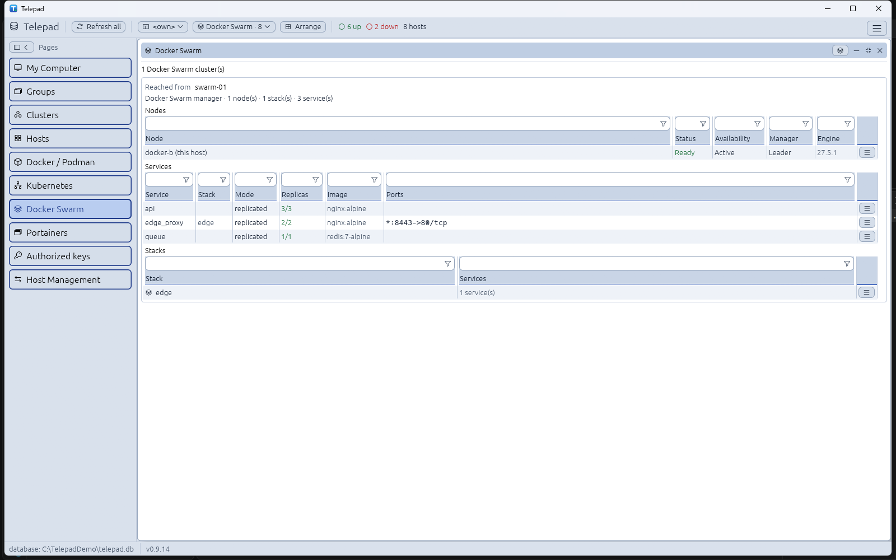

**Portainers.** Register a Portainer with an API token (kept in the system's password store)
and Telepad reaches it through an SSH tunnel to its host. Each stack has a page with its
containers (start, stop, restart, pause, kill, remove — the risky ones ask first) and its
compose file in Telepad's editor, with a Variables page and a review before **Update the
stack**.

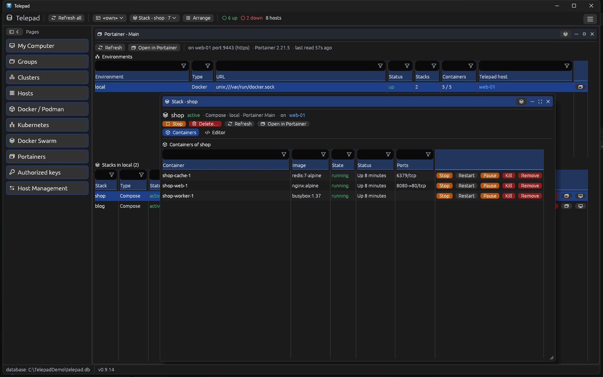

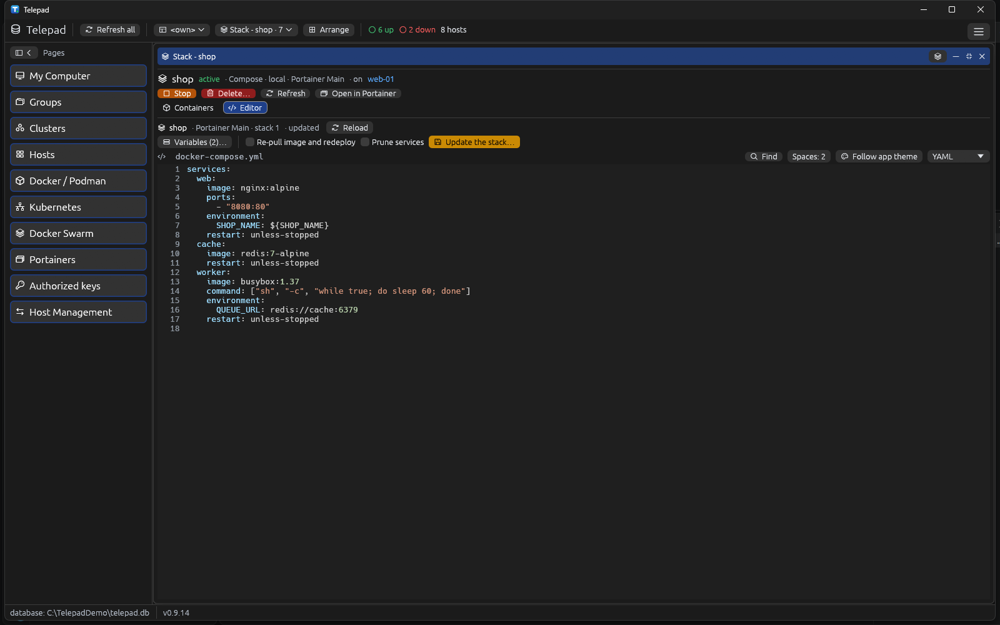

**Files and the editor.** A file window per host, this computer on the left and the host on
the right, over SFTP. Files open in a VS Code-like editor with colour schemes (Dark Modern,
Light Modern, Monokai, Solarized …), a language picker and an indentation menu (tabs or
spaces, re-indent 2 ↔ 4).

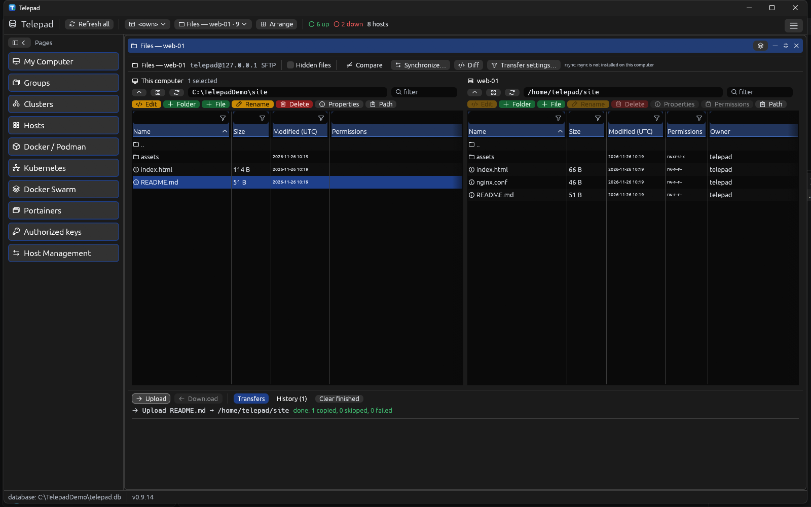

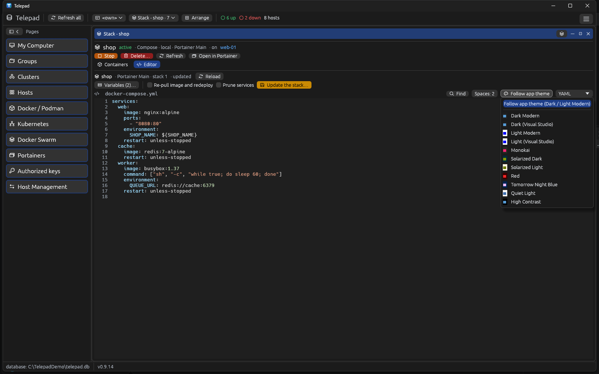

**Authorized keys** shows who can log in where, grouped by the `#` comments of
`authorized_keys`, and adds or revokes one key on many servers at once; **My keys** creates
and converts the key pairs on this computer.

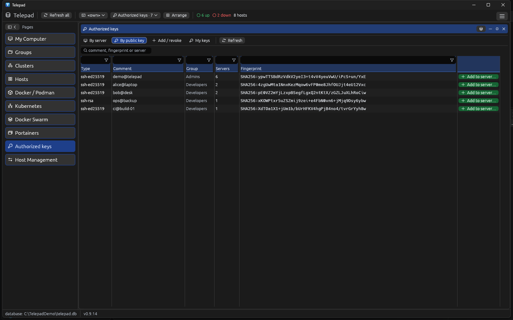

**Host Management** compares Telepad's hosts with an OpenSSH config and copies, edits or
deletes per host or all at once, with a preview and a backup before the file is written.

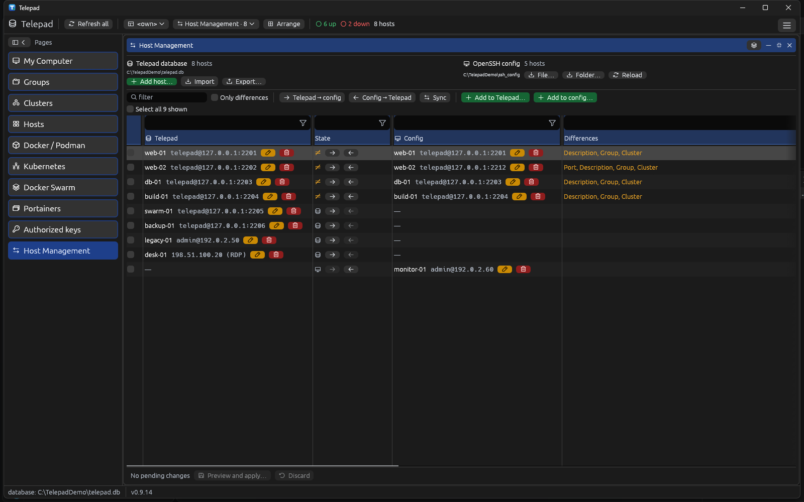

**Workspaces keep everything, and ask first.** Leaving a workspace (or closing Telepad)
lists what would be lost — unsaved editor text, database changes not posted, host or key
changes not applied — in one question; file transfers keep running in the background.

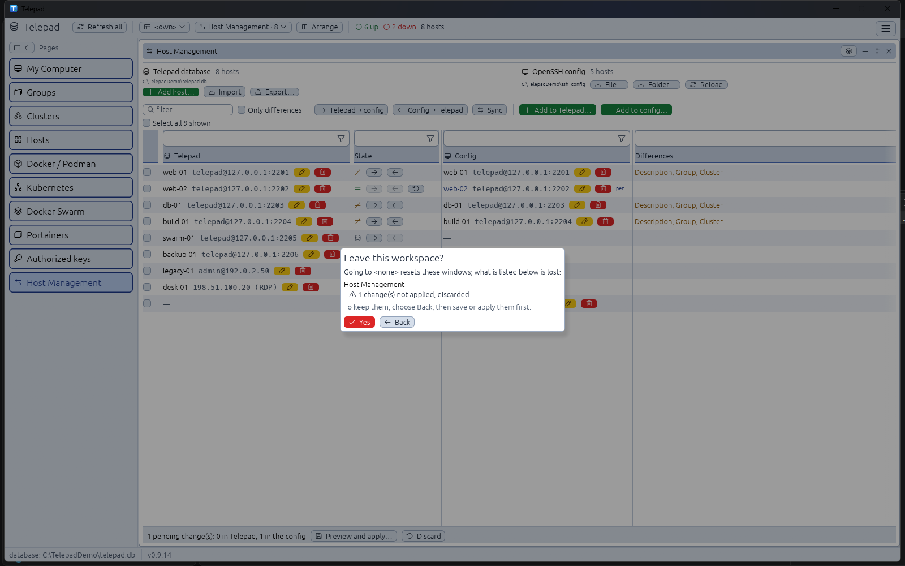

Make sure `ssh web01` works in a terminal first: Telepad uses exactly the same client,
keys and options.

Everything else is in the [user manual](docs/USER_MANUAL.md).

## Documentation

- [User manual](docs/USER_MANUAL.md): how Telepad works, window layout and workspaces,
  overview and host detail, adding and importing hosts, Remote Desktop settings, files and
  their history, Authorized keys and My keys, the database browser and its SQL log, BMC
  sensors, updates, troubleshooting, command line — with annotated screenshots
- [Developer guide](docs/DEVELOPER_GUIDE.md): how the code is built — the egui UI (inner windows, the table
  component with filters, value lists and paging, the editor), the Model–View–Update core, and
  how Telepad authorizes against hosts, databases and the Portainer API
- [Contributing](CONTRIBUTING.md): building from source, reporting bugs, making a change, releasing
- [Security](SECURITY.md): security model and how to report a vulnerability
- [AGENTS.md](AGENTS.md): architecture and conventions
- [Change history](CHANGE_HISTORY.md)

## License

Licensed under either of [Apache License, Version 2.0](LICENSE-APACHE) or
[MIT license](LICENSE-MIT) at your option. Unless you explicitly state otherwise,
any contribution you submit for inclusion in this work, as defined in the Apache-2.0
license, is dual licensed as above, without any additional terms or conditions.

Bundled assets: [Phosphor icons](crates/telepad-gui/assets/fonts/LICENSE-Phosphor.txt) (MIT) and
[Simple Icons](crates/telepad-gui/assets/os/ATTRIBUTION.md) OS logos (CC0).
