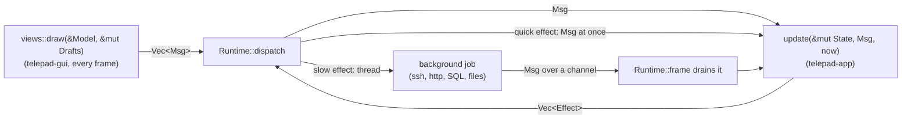
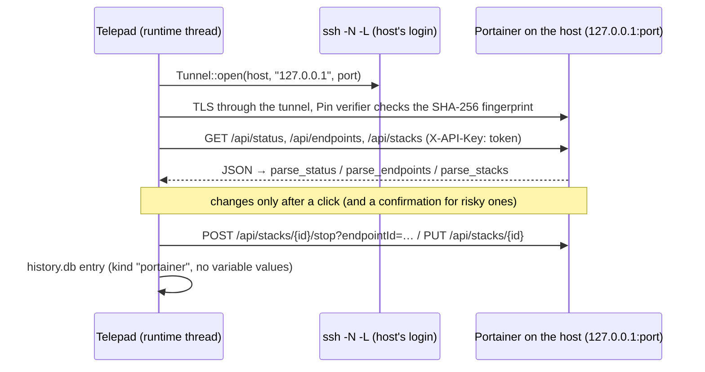

# Telepad developer guide

How Telepad is built, for developers who want to change it. It explains the parts that are
not plain egui or plain Rust: the Model–View–Update core, the single-window workspace, the
table component (sort, filter row, searchable value list, paging, exports), the text editor,
and how Telepad authorizes against hosts, databases and the Portainer API.

[`AGENTS.md`](../AGENTS.md) is the map (every module and its role, the conventions, the
read-only rule and its exceptions); this guide is the walk-through. Build, test and release
steps are in [`CONTRIBUTING.md`](../CONTRIBUTING.md). Each crate has its own page in
[`docs/crates/`](crates/), and every outside library is explained in
[`DEPENDENCIES.md`](DEPENDENCIES.md). Paths below are relative to the
repository root; names are the real ones in the code.

**Contents:** [Crates](#crates) · [Model–View–Update](#modelviewupdate) ·
[Adding a feature, end to end](#adding-a-feature-end-to-end) · [egui as Telepad uses it](#egui-as-telepad-uses-it) ·
[Inner windows and workspaces](#inner-windows-and-workspaces) · [The table component](#the-table-component) ·
[The searchable value list](#the-searchable-value-list) · [Paging and continuous mode](#paging-and-continuous-mode) ·
[The text editor](#the-text-editor) · [Authorization and outside services](#authorization-and-outside-services) ·
[The Portainer API](#the-portainer-api) · [Persistence](#persistence) · [Testing](#testing)

## Crates

```
telepad-gui ──► telepad-app ──► telepad-core ◄── telepad-check
     └──────────────────────────────►┘
```

The workspace (`Cargo.toml`, `[workspace] members`) has four crates. Arrows are the only
allowed dependencies. Each crate has its own page with its modules, rules, how the others use
it and how to extend it:

| Crate | Builds | What lives there | Rules | Details |
|---|---|---|---|---|
| `telepad-core` | library | everything that touches the outside world or is pure domain logic: ssh, the collection script and its parsers, SQLite stores, the database client, SFTP, the Portainer client, key formats, `platform.rs` | no GUI; OS-specific code only in `platform.rs` | [docs/crates/telepad-core.md](crates/telepad-core.md) |
| `telepad-app` | library | the state and all behaviour: `State { model, drafts }`, `Msg`, `Effect`, `update()` | no GUI, no I/O, no outside libraries, time is a parameter | [docs/crates/telepad-app.md](crates/telepad-app.md) |
| `telepad-gui` | `telepad` | egui views, the runtime that executes effects, shared widgets, the table component, the editor | views never do I/O | [docs/crates/telepad-gui.md](crates/telepad-gui.md) |
| `telepad-check` | `telepad-check` | a headless CLI over `telepad-core`: collect once as text / JSON, update check, Log info, My Computer, Portainers | read-only | [docs/crates/telepad-check.md](crates/telepad-check.md) |

`cargo build` builds the two binaries (`default-members` = `telepad-gui`, `telepad-check`);
`cargo test --workspace` tests all four.

The rule that keeps this manageable: **all behaviour is in `telepad-app` and testable without
a window, a network or a disk**; `telepad-gui` only draws and runs effects.

**Outside libraries** — eframe / egui, egui_extras, arboard, rfd, regex, rusqlite, rustls,
keyring, the database drivers, the export and key-format crates — are each described in
[DEPENDENCIES.md](DEPENDENCIES.md): what it is, which crate and modules use it, when it runs,
why Telepad uses it and how (features, API, rules). GUI libraries stay in `telepad-gui`,
`telepad-app` has none, and everything else is in `telepad-core`. A PR that adds a library
adds its entry there.

## Model–View–Update



- **`Model`** (`crates/telepad-app/src/state.rs`) is what the app knows: hosts and their
  reports, sessions (file windows, databases, Portainer pages), the workspace. Only
  `update()` changes it.
- **`Drafts`** is what the user is typing or toggling and has not committed: form fields,
  filter boxes, table sort / filter / page (`Drafts::tables`), the editor texts. Views may
  edit drafts directly; anything that must be saved, sent or checked goes through a `Msg`.
- **`Msg`** (`msg.rs`) is an intent ("user clicked Save") or a result ("hosts loaded").
- **`Effect`** is work for the outside world ("save these view settings", "read this
  Portainer"). `update()` returns them; it never performs them.
- **The runtime** (`crates/telepad-gui/src/runtime.rs`) executes effects. Quick ones return
  the next `Msg` at once (`Runtime::run` → `Option<Msg>`); slow ones go to
  `Runtime::background`, a thread that sends its `Msg` back over a channel and asks egui to
  repaint. `Runtime::frame` drains the channel at the start of every frame. The UI thread
  never waits on ssh or the network (the only blocking call allowed is a native file
  dialog, opened by the runtime).

The loop itself is short (`crates/telepad-gui/src/app.rs` and `runtime.rs`):

```rust
// app.rs, every frame
self.runtime.frame(&mut self.state);              // results of background jobs → update()
let State { model, drafts } = &mut self.state;
let msgs = views::draw(root, model, drafts, Instant::now());
for msg in msgs {
    self.runtime.dispatch(&mut self.state, msg);
}

// runtime.rs
pub fn dispatch(&mut self, state: &mut State, msg: Msg) {
    let mut queue = VecDeque::from([msg]);
    while let Some(msg) = queue.pop_front() {
        for effect in telepad_app::update(state, msg, Instant::now()) {
            if let Some(next) = self.run(effect) {
                queue.push_back(next);
            }
        }
    }
}
```

Big features keep their own sub-message types so `msg.rs` stays readable: `FmMsg` (file
windows), `EdMsg` (editor), `DbMsg` (databases), `PtMsg` / `PtEffect` (Portainers),
`StMsg` (groups and clusters), `WsMsg` (workspace), `TableMsg` (table exports). Each has
its own `update` in its module (`files.rs`, `editor.rs`, `db.rs`, `portainer.rs`, …),
called from the main `update()`.

## Adding a feature, end to end

The checklist in `AGENTS.md` is: add the `Msg` (and `Effect` if it needs the outside world)
→ handle it in `update()` with a test → run the effect in `runtime.rs` → draw or emit it in
a view. Here is a real, small one: the editor colour scheme setting (#183).

**1. State.** The choice is a view setting, saved with the others, so it is a draft and part
of `UiPrefs` (`crates/telepad-core/src/store.rs`, saved as `settings` key `ui_editor_scheme`):

```rust
// telepad-core/src/store.rs
pub struct UiPrefs {
    // …
    /// Editor colour scheme (#183) by its key; empty = follow the app theme.
    pub editor_scheme: String,
}
// ui_prefs() reads it:   editor_scheme: self.setting("ui_editor_scheme")?.unwrap_or_default(),
// set_ui_prefs() writes: ("ui_editor_scheme", p.editor_scheme.as_str()),

// telepad-app/src/state.rs
pub struct Drafts {
    // …
    pub editor_scheme: String,
}
```

**2. Message and update.** One message; it saves only when something changed:

```rust
// telepad-app/src/msg.rs
/// Editor colour scheme (#183) by key; empty = follow the app theme.
SetEditorScheme(String),

// telepad-app/src/update.rs
Msg::SetEditorScheme(key) => {
    if d.editor_scheme != key {
        d.editor_scheme = key;
        fx.push(Effect::SaveUiPrefs(d.ui_prefs(m)));
    }
}
```

**3. Test** (`crates/telepad-app/src/tests.rs`) — behaviour, not pixels:

```rust
let fx = update(&mut s, Msg::SetEditorScheme("monokai".into()), t0);
assert!(matches!(&fx[..], [Effect::SaveUiPrefs(p)] if p.editor_scheme == "monokai"));
assert!(update(&mut s, Msg::SetEditorScheme("monokai".into()), t0).is_empty());
```

**4. Runtime.** `Effect::SaveUiPrefs` already existed (it writes `UiPrefs` through
`Store::set_ui_prefs`), so nothing new was needed. A new effect gets a match arm in
`Runtime::run`, on a thread through `self.background(move || …)` when it can be slow.

**5. View.** The picker pushes the message; drawing reads the choice once per frame:

```rust
// telepad-gui/src/views/text_editor.rs
if ui.selectable_label(chosen == s.key, s.name).clicked() {
    out.push(Msg::SetEditorScheme(s.key.to_string()));
}

// telepad-gui/src/app.rs, every frame
crate::editor_theme::set(&self.state.drafts.editor_scheme);
```

Then the docs: `docs/USER_MANUAL.md` for the user, `AGENTS.md` for the module map,
`CHANGE_HISTORY.md` for the record.

## egui as Telepad uses it

Telepad uses egui 0.37 (immediate mode): every frame the views are called again with the
current `Model` and draw everything; there is no retained widget tree. A few things matter
more here than in a small egui app.

- **Ids.** Widgets that keep state across frames (text boxes, scroll areas, combo boxes,
  tables) need ids that stay the same. Telepad builds them from what the thing is, e.g.
  `egui::Id::unique(("pt-choose", …))` or `Spec::new(("kube-nodes", key), …)`. Two windows
  that show the same page kind must differ in their id (a session id is part of it).
- **Temp data.** Small view-only state that is not worth a draft (an open dropdown, the
  editor's find bar for an embedded editor, the last indentation choice) lives in egui's
  temp memory: `ui.data(|m| m.get_temp(id))` / `ui.data_mut(|m| m.insert_temp(id, v))`. It
  is gone after a restart, which is intended.
- **Modals.** In-window dialogs use `egui::Modal` (delete confirmations, the leave
  question, Portainer confirmations). Telepad never opens a second OS window.
- **Themes.** `crates/telepad-gui/src/widgets.rs` builds the light and dark `egui::Visuals`
  (`light_visuals`, `dark_visuals`) and a `Palette` (status colours, action button fills,
  table header band, title bars). `widgets::pal()` gives the palette of the theme in use;
  `set_dark_mode` is called once per frame. Tests in `widgets.rs` check contrast ratios
  (text ≥ 7 : 1, secondary text ≥ 4.5 : 1 on every surface), so a colour change that hurts
  readability fails `cargo test`.
- **Action buttons.** `widgets::act_button` / `act_small` with `Act::Danger` (red: delete,
  revoke, kill), `Act::Edit` (yellow), `Act::Add` (green), `Act::Caution` (amber: stop,
  open a session). Use them instead of hand-coloured buttons.
- **Icons** come from the Phosphor font (`crates/telepad-gui/src/icons.rs`, constants like
  `icons::STACK`, `icons::PALETTE`; `icons::label(icon, text)` puts one before a label). The
  test `every_character_in_the_ui_has_a_glyph` fails when a string uses a character no
  bundled font has; add the glyph's constant in `icons.rs` (check the code point in
  `assets/fonts/Phosphor.ttf`) rather than pasting a symbol.

## Inner windows and workspaces

Telepad is one OS window with pages as windows inside it (WinBox style). The model is in
`crates/telepad-app/src/workspace.rs`, the drawing in `crates/telepad-gui/src/views/workspace.rs`.

- **`Win`** names a page: `Win::Overview`, `Win::Host`, `Win::Portainer(id)`,
  `Win::PtStack(id)`, `Win::Files(id)`, … Opening a page that is open already raises it.
- **`Group`** is one inner window: its `tabs: Vec<Win>`, the `active` tab, `rect`,
  `minimized`, `maximized`, a `raise` counter, and `unsnap` (the size before a snap layout).
- **`Workspace`** keeps the groups and their order, and offers `open` (which also raises a
  window that is open already), `close`, `update(WsMsg)` (move, resize, minimize, maximize, tabs, snap), `save` / `restore` of a
  layout string, and `sync` (closes windows whose session is gone).
- The view draws each group as an `egui::Area` on the `Middle` layer with its own title bar,
  handles dragging and resizing, and paints the snap preview and the snap-layout picker on
  higher layers. A page's content is drawn by the private `page(ui, m, d, win, focused, out, now)` in
  `views/mod.rs`.
- **Named workspaces** (`WkMsg`) are saved in `preference.db` (`crates/telepad-core/src/prefs.rs`)
  as a layout string per workspace; session windows are saved as keys like
  `files:<alias>`, `db:<target>`, `portainer:<name>`, `group:<name>`, and reopened when the
  workspace comes back.

To add a page: a `Win` variant, its title and default size in `views/workspace.rs`, a
branch in `page` (`views/mod.rs`), a sidebar button or another way to `open` it, and — if it should
come back with a workspace — a layout key in `Workspace::save` / `restore`.

## The table component

Every table is built with `crates/telepad-gui/src/table.rs` (never a bare
`egui_extras::TableBuilder` or `egui::Grid` with a header row). Its state lives in
`telepad-app` (`grid.rs`, `pager.rs`) so it can be tested.

| Piece | Where | What it is |
|---|---|---|
| `Col` | `table.rs` | one column: title, width, `sort`, `filter`, `export`, `mono`, `named` (for icon-only titles), `tip`; builders `Col::new`, `Col::action` (buttons: no sort / filter / export), `.no_sort()`, `.no_filter()`, `.mono()`, `.initial(w)`, `.remainder()` |
| `Spec` | `table.rs` | how the table looks: id, export title, columns, `Kind` (`Simple` = as tall as its rows, `Fill` = fills and scrolls, `Paged` = pager footer), row height, selection, drag, minimum width |
| `show` | `table.rs` | rows in memory: you hand it `cells: &[Vec<String>]`; it filters and sorts by itself with the `TableState` you pass |
| `controlled` | `table.rs` | the view keeps its own order (Hosts, file panes, database grid, Log info): you pass `Controlled { sort, filters, rows, text, all }` and get the header clicks and filter changes back in `Output` |
| `TableState` | `telepad-app/src/grid.rs` | `sort: Option<(col, Dir)>`, `filters: Vec<String>`, `pager: Pager`; kept in `Drafts::tables` under a string key |
| `Output` | `table.rs` | `clicked`, `double_clicked`, `rows` (responses, for drag and drop), `sort`, `filter_changed`, `export`, `msgs`, `near_bottom`, `fits` |
| `Ev` | `table.rs` | what your closure draws: `Ev::Cell { row, col }`, `Ev::Menu { row, col }` (your right-click items), `Ev::HeaderMenu` |

**A new table** — the Kubernetes nodes table (`crates/telepad-gui/src/views/cluster.rs`) is a
complete example:

```rust
let cols = [Col::new("Node"), Col::new("Ready"), Col::new("Version")];
let cells: Vec<Vec<String>> = k.nodes.iter().map(|n| vec![
    n.name.clone(),
    if n.ready { "Ready" } else { "Not ready" }.to_string(),
    n.version.clone(),
]).collect();
let title = format!("Kubernetes nodes ({key})");
let spec = Spec::new(("kube-nodes", key), &title, &cols);
let st = table::state(d, format!("kube-nodes:{key}"));   // TableState in Drafts::tables
let o = table::show(ui, &spec, st, &cells, |ui, ev| {
    if let Ev::Cell { row, col } = ev {
        match col {
            1 => colored(ui, ok_color(k.nodes[row].ready), &cells[row][1]),
            2 => table::weak(ui, &cells[row][2]),
            c => table::text(ui, &cells[row][c]),
        }
    }
});
out.extend(o.msgs);   // exports (CSV / Excel / PDF / JSON) travel as messages
```

Things to know:

- **`cells` is the truth for sorting, filtering and exports**, even when a cell is drawn as
  a bar, a link or a coloured label. Put the plain text there (`"75%"`, `"1.5 GiB"`,
  `"192.0.2.9"`): sorting understands numbers with units and addresses
  (`grid::compare` / `grid::natural` / `grid::value`), and `filter_match` compares by value
  (`>50` finds `75%`).
- **Rows passed to your closure are source rows**, not drawn positions: index your own
  data with `row`, never with a counter.
- **Buttons in a row** go in a `Col::action("")` column; their clicks are handled inside the
  closure and pushed as messages.
- **Right-click menu.** Your items come first (`Ev::Menu`), then the component adds
  Filter by *column*: *value*, Clear All Filters, Export as CSV / Excel / PDF and Copy as JSON.
  Exports take every row the filters let through, in the shown order, from all pages,
  without button / icon columns; they become `Msg::Table(TableMsg::Export …)` and the runtime
  writes the file (`telepad-core/src/table_export.rs`).
- **Widths.** Columns are fitted to their text and fill the page (`fill_widths`); a width the
  user drags is kept in a `Layout` until a double-click on the border or *Auto-fit columns*.
- **Filter row rules** (`grid::filter_match`): text = contains (any case), `=x` equal, `!x`
  not equal, `>x` / `<x` (numbers by value, else text order — dates work as text), `NULL`
  empty, `!NULL` has a value.

## The searchable value list

The funnel at the end of each filter box (#170) opens a list of that column's values. It is
drawn inside `table.rs` (`struct Dropdown` in egui temp data, an `egui::Area` popup), with the
logic in `grid.rs` so it is tested without a GUI:

```rust
// grid.rs
pub const VALUES_CAP: usize = 500;
pub fn distinct_values<'a>(cells: impl IntoIterator<Item = &'a str>, cap: usize) -> Vec<String>;
pub fn search_values<'a>(values: &'a [String], query: &str) -> Vec<&'a str>;
pub fn row_matches_except(cell: &dyn Fn(usize) -> String, filters: &[String], skip: usize) -> bool;
pub fn exact_filter(value: &str) -> String;   // "Data" → "=Data", "" → "NULL"
```

1. When the funnel opens, the component walks the rows that pass **every other** filter box
   (`row_matches_except(…, skip = this column)`) — so every value offered gives results — and
   collects the column's values with `distinct_values` (trimmed, once each ignoring case,
   natural order, empty last, at most `VALUES_CAP`).
2. Typing in the list's search field narrows it with `search_values` (contains, any case).
3. Picking a value writes `exact_filter(value)` into the box; *Clear filter* empties it. The
   table then filters as if the user had typed it.

For `controlled` tables the "every other box" walk needs all source rows: pass them in
`Controlled::all`. Pass `None` when the rows are already filtered elsewhere (the database grid
filters on the server, so its list holds the loaded rows only).

## Paging and continuous mode

`Kind::Paged` tables put `widgets::pager_bar` under the rows; the state is
`telepad_app::pager::Pager` (inside `TableState`):

| Field / function | Meaning |
|---|---|
| `per_page`, typed rows per page | empty means `EMPTY_SIZE` (100); above `ASK_ABOVE` the bar asks before applying, `MAX_SIZE` caps it |
| `range(total)` | `(start, end, page_count)` of the rows to draw |
| `go(Go::First / Prev / Next / Last, total)`, `apply_page` (the typed page number), `apply_per_page` | the footer buttons and boxes |
| `record_info(total)` | "Record [a - b] of n" |
| `continuous`, `toggle()` | continuous mode: no pages, rows load as you scroll |
| `start_mode(width)` | a table first shown narrower than `NARROW` (768 points) starts continuous |
| `wants_more(total, near_bottom, fits)` / `more(total)` | load the next batch when scrolled near the bottom, or while the rows do not fill the view (up to `FILL_MAX`) |
| `reset()` | back to the first row (a new sort, filter or page size) |

`show` does all of this for in-memory rows. A server-backed table (the database grid) uses
`controlled` and asks for more itself: `DbMsg::DataMore` appends a page, `DataView::appending`
/ `exhausted` stop it. Use the same pattern for any table whose rows come from somewhere
slow.

## The text editor

One editor serves the file windows and the Portainer stack editor.

| Part | Where |
|---|---|
| Tabs, saving, conflicts, unsaved question, language, indentation per tab | `crates/telepad-app/src/editor.rs` (`FileEditor`, `EdTab`, `EdDraft`, `EdMsg`) |
| Decode / encode keeping CRLF and BOM, find / replace (regex), go to line, Tab indent, `Indent` + `convert_indent` | `crates/telepad-core/src/files/text.rs` |
| Language detection and the line lexer → `Tok` spans | `crates/telepad-core/src/files/syntax.rs` (`Lang`, `Lang::detect`, `syntax::highlight`) |
| Read / save with the `Stamp` check, `.telepad-part` + rename | `crates/telepad-core/src/files/edit.rs` |
| Drawing: gutter, colours, current line, find bar, status bar | `crates/telepad-gui/src/views/text_editor.rs` |
| Colour schemes | `crates/telepad-gui/src/editor_theme.rs` |

**How the text is drawn.** The text box is an `egui::TextEdit::multiline(...).code_editor()`
with a custom **layouter**: egui calls it whenever it needs the galley, and
`text_editor::layout` returns a `LayoutJob` with one `TextFormat` per token. Lexing the whole
file on every keystroke would be slow, so the spans are cached in temp data under a hash of
`(text, lang)`; files above 2 MiB are drawn without colours. Before the text box, `code()`
applies the colour scheme to the editor's own `Ui` (`Scheme::apply` sets background, text,
selection, cursor and the weak / strong colours used for line numbers) and paints the current
line, diff marks and find matches as shapes under the text. Line numbers are painted in a
gutter that stays at the left edge when the text scrolls sideways.

**Keys.** `code()` consumes Tab / Shift+Tab before the text box sees them and applies
`text::indent` with the tab's `Indent` unit, then moves the cursor through
`TextEdit::load_state` / `store`. Ctrl+F / H / G, F3 and Esc are handled by the window.

**Indentation** (#182) is `EdTab::indent` (detected on load with `Indent::detect`).
`EdMsg::SetIndent` changes what Tab inserts; `EdMsg::ConvertIndent { tab, to, sel }` rewrites
the draft text with `convert_indent` (leading whitespace only; levels are rescaled, a partial
level stays as spaces; YAML refuses tabs via `editor::indent_allowed`).

**The embedded editor** (`text_editor::embedded`) is the same editor for a text that is not a
file — the Portainer stack's compose file. It builds a throwaway `EdTab` each frame, keeps its
`EdDraft`, chosen language and indentation in egui temp data keyed by the window, and writes
the text back into the `&mut String` it was given. The indentation choice is stored with a
hash of the text, so a text replaced from outside (Reload) is detected again.

**Adding a language:** a `Lang` variant with its `name()`, a rule in `Lang::detect` (file
name, folder or `#!` line) and a lexer branch in `syntax::highlight` that returns
`(Range<usize>, Tok)` spans; add a case to the detection test in `syntax.rs`.

**Adding a colour scheme:** one entry in `editor_theme::SCHEMES` (key, name, dark flag,
background, text, line numbers, current line, selection and the seven token colours). The
test `every_scheme_is_readable_and_complete` checks contrast (text and line numbers 4.5 : 1,
tokens 3 : 1) and that the dark flag matches the background.

## Authorization and outside services

Telepad holds no passwords of its own and opens nothing to the network. Everything goes
through what the user already has.

**SSH.** Hosts are reached with the system OpenSSH client and the generated
`telepad.ssh_config` (rendered from `telepad.db`): `ssh -F telepad.ssh_config -T -o BatchMode=yes
-o StrictHostKeyChecking=accept-new -o ConnectTimeout=… <alias> sh -s`, the collection script
on stdin (`crates/telepad-core/src/collector.rs`). `BatchMode=yes` means ssh never prompts: a
key that needs a passphrase must be in the ssh agent. `accept-new` trusts a host key on first
use and refuses a changed one. Host values are passed as separate process arguments, never
through a shell string, and every host field is validated (`HostEntry::validate`) before it
is saved or rendered into the config. Commands Telepad runs on a host are read-only; the
documented exceptions (Docker actions, Authorized keys, file copies, database edits, Portainer
actions, BMC setup, journal access) all start from a user action and are listed in
`AGENTS.md` ▸ Conventions.

**Tunnels.** Databases and Portainers are reached through `ssh -N -L` on the host's normal
login (`crates/telepad-core/src/db/tunnel.rs`):

```rust
// tunnel_args(): the host's own ssh arguments, then
"-N", "-o", "ExitOnForwardFailure=yes", "-o", "ServerAliveInterval=30",
"-L", "127.0.0.1:<local port>:<address on the host>:<port>", "<alias>"
```

`Tunnel::open` picks a free local port, starts ssh and waits until the port accepts
connections; the tunnel closes when the `Tunnel` is dropped, and `close_all` on exit. Nothing
listens on anything but `127.0.0.1` on this computer. (My Computer's databases connect to
`127.0.0.1` directly, without a tunnel.)

**Secrets in the OS password store.** `crates/telepad-core/src/db/secret.rs` wraps the `keyring`
crate (Windows Credential Manager, macOS Keychain, Linux Secret Service):

| Service | Key | Holds |
|---|---|---|
| `Telepad database` | the connection's `DbTarget::key` | database passwords, only when the user ticks *save password* |
| `Telepad Portainer` | `portainer:<name lowercased>` | Portainer API access tokens |
| Windows Credential Manager (`platform.rs`, `CredWriteW`) | `TERMSRV/<address>` | the Remote Desktop password, only when the user saves it; never read back |

Secrets are never written to `telepad.db`, `preference.db`, `history.db`, an export or a log.
`db::Secret` prints as `***` in debug output, so it cannot end up in a log by accident.

## The Portainer API

`crates/telepad-core/src/portainer.rs` is a small, self-contained client; the app side is
`crates/telepad-app/src/portainer.rs` (pages, Stack page, editor, confirmations) and the runtime
arm `run_portainer` in `runtime.rs`.



- **Transport.** No HTTP library: `request_bytes` writes the HTTP/1.1 request by hand (the
  token goes only in the `X-API-Key` header), `parse_response` reads status, headers and a
  plain or chunked body. Reads are `GET` only.
- **TLS and the certificate pin.** Portainer's certificate is usually self-signed, so
  ordinary validation would fail. `rustls` is configured with a custom
  `ServerCertVerifier`, `Pin`:

  ```rust
  impl rustls::client::danger::ServerCertVerifier for Pin {
      fn verify_server_cert(&self, end_entity: &CertificateDer<'_>, …) -> Result<…> {
          let fp = fingerprint(end_entity.as_ref());        // SHA-256 of the DER
          *self.seen.lock()? = Some(fp.clone());          // reported back to the caller
          match &self.want {
              Some(w) if !w.eq_ignore_ascii_case(&fp) => Err(…"not the pinned one"…),
              _ => Ok(ServerCertVerified::assertion()),   // first use, or the pinned one
          }
      }
      // the handshake signatures are still verified (verify_tls12/13_signature)
  }
  ```

  The first good read stores the fingerprint in the `portainers` table; a different
  certificate later is refused (`ReadError::CertChanged`) until the user accepts it — the
  same trust-on-first-use idea as SSH's `accept-new`.
- **Token.** `load_token` / `save_token` / `forget_token` use the `Telepad Portainer` service;
  a missing token is `ReadError::NoToken`, a 401 is `ReadError::Rejected`. `MIN_VERSION`
  (2.11.0) is the oldest Portainer with access tokens.
- **Changes** are `Conn::act(&Action)` and `Conn::update_stack(&StackUpdate, expect)`:

  | `Action` / call | Request |
  |---|---|
  | `StackStart` / `StackStop` | `POST /api/stacks/{id}/start` / `stop` `?endpointId=` |
  | `StackDelete` | `DELETE /api/stacks/{id}?endpointId=&external=false` |
  | `Container { op }` | `POST /api/endpoints/{env}/docker/containers/{id}/{start, stop, kill, restart, pause, unpause}`, `DELETE …/containers/{id}?force=true&v=0/1` |
  | `update_stack` | `PUT /api/stacks/{id}?endpointId=` with the compose file, `Env`, `Prune`, re-pull; it first re-reads the stack and stops with `ReadError::Changed` if its `UpdateDate` moved (unless the user chose Overwrite) |

  The app decides which actions need a confirmation (`needs_confirm`: every stack action;
  for containers only the risky ones, `ContainerOp::risky` = kill and remove; a stack delete
  needs the name typed), and the runtime writes each change to
  `history.db` (kind `portainer`). Nothing is sent from a refresh or in the background.
- **Fixtures.** The parsers are tested against JSON in `crates/telepad-core/tests/fixtures/portainer/`;
  `telepad-check --portainer <name> [--stack <stack>]` reads a real one headless (variable
  names only, never values).

## Persistence

| File | Module | Notes |
|---|---|---|
| `telepad.db` | `telepad-core/src/store.rs` | hosts, settings, groups / clusters, database connections, Remote Desktop settings, Portainers. `PRAGMA user_version` is the schema (`SCHEMA_VERSION`); `Store::open` migrates step by step. `schema_meta.min_compatible` (#180) says which older schema can still use the file: bump `SCHEMA_VERSION` for every schema change and `MIN_COMPATIBLE_SCHEMA` only when older builds would misread the file. `check_newer_schema` looks read-only first, so a too-new file is never opened for writing |
| `telepad.ssh_config` | `store.rs` | generated from `telepad.db` on every change (atomic write); never edit |
| `preference.db` | `prefs.rs` | named workspaces and their layouts |
| `history.db` | `history.rs` | transfers, file operations, SQL log, Portainer changes; 90 days / 50 000 rows; `mask_secrets` hides passwords in SQL |
| `update.db` | `strategy.rs` | Update Strategy, paused hosts, last known static / slow facts |

Each of the four SQLite files has its own writer thread in the runtime and is flushed on exit;
`update()` only emits effects such as `Effect::SaveUiPrefs`.

## Testing

| Kind | Where | Run |
|---|---|---|
| Behaviour of `update()` (no GUI, no network) | `crates/telepad-app/src/tests*.rs` (one file per feature) | `cargo test -p telepad-app` |
| Parsers against captured output | `crates/telepad-core/src/parse.rs` + `tests/fixtures/` | `cargo test -p telepad-core` |
| Pure helpers (filters, indentation, key formats, SQL quoting) | next to the code, `#[cfg(test)]` | `cargo test --workspace` |
| GUI facts that matter (contrast of every theme and scheme, glyph coverage) | `widgets.rs`, `editor_theme.rs`, `icons.rs` | `cargo test -p telepad-gui` |
| Live services | env vars: `TELEPAD_TEST_SSH` (the `tests/sshd` lab image), `TELEPAD_TEST_MYSQL`, `TELEPAD_TEST_PG`, `TELEPAD_TEST_KEYGEN`, … | `cargo test` with the variable set |

`cargo fmt --all --check`, `cargo clippy --workspace --all-targets -- -D warnings` and
`cargo test --workspace` must pass before a change goes in; CI runs them on Windows, macOS and
Linux. Test data uses documentation addresses (`192.0.2.0/24`, `198.51.100.0/24`) and made-up
names, never a real inventory.

**Screenshots** for the manual come from a demo lab: a few `tests/sshd`-style containers with
the Docker CLI as made-up hosts on `127.0.0.1`, a Docker-in-Docker engine with demo stacks, a
second one in swarm mode, and a local Portainer CE that shares the network of one of the demo
hosts (so Telepad reaches it through its normal SSH tunnel). Start Telepad with
`--db <demo folder>\telepad.db --config <demo folder>\config` so nothing of your own inventory
appears.
