# Telepad user manual

How to use Telepad once it is [installed](../README.md#install). For a first run see the
[quick start](../README.md#quick-start).

**Contents:** [How Telepad works](#how-telepad-works) · [Window layout](#window-layout) · [Workspaces](#workspaces) · [Overview](#overview) · [My Computer](#my-computer) · [Host detail](#host-detail) · [Refreshing](#refreshing) · [Adding, editing and removing hosts](#adding-editing-and-removing-hosts) · [Import and export](#import-and-export) · [Files](#files-upload--download--manage--edit) · [Authorized keys](#authorized-keys-list-add-revoke) · [Database browser](#database-browser-mariadb--mysql--postgresql) · [Fan speeds and BMC temperatures (IPMI)](#fan-speeds-and-bmc-temperatures-ipmi) · [Updates](#updates) · [Troubleshooting](#troubleshooting) · [Command line](#command-line)

## How Telepad works

Telepad runs on your computer only. It reaches your hosts with the same OpenSSH client and
keys you use in a terminal, and keeps what it knows in a few files next to each other.

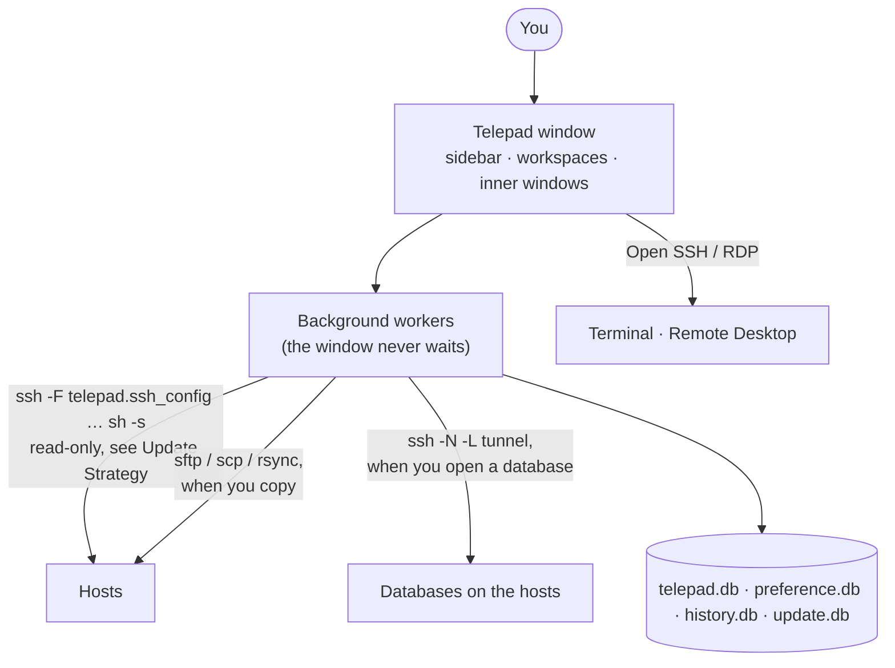

| File | Holds | Never holds |
|---|---|---|
| `telepad.db` | hosts, settings, saved database connections, Remote Desktop settings | passwords (database passwords go to the system password store, if you tick it) |
| `telepad.ssh_config` | the ssh config Telepad generates from `telepad.db` | — (rewritten on every change; do not edit) |
| `preference.db` | workspaces: which windows, where, which folders / files / database | file contents, passwords |
| `history.db` | transfers, file changes and SQL statements, 90 days | file contents, passwords (masked in SQL) |
| `update.db` | the [Update Strategy](#update-strategy) (pause, paused hosts, which checks run and how often) and each host's last known OS / CPU info, addresses, ports and pending updates | live metrics, passwords |

On macOS and Linux Telepad keeps `telepad.db`, `preference.db`, `history.db` and `update.db` (and
SQLite's `-wal` / `-shm` files next to them) readable by your user only (mode `600`);
if it cannot, the status bar says which file. On Windows the folder's permissions apply:
the per-user data folder (`%APPDATA%\Telepad`) is private; a portable copy next to the exe
is as private as that folder.

**What runs on a host.** Monitoring is one read-only shell script per round. Everything
that changes a host is something you start and confirm: a Docker action (shown in a
terminal), adding or revoking a key (you type `add` / `revoke`), a database change (you see
the SQL and press **Run**), copying or changing files (Upload, Download, New, Rename,
Delete, Save).

## Window layout

Telepad is one window (like MikroTik WinBox): pages open as windows **inside** it.

```
--------------------------------------------------------------------------
Telepad | Refresh all | ▤ <own> ▾ | ▣ Hosts · 3 ▾ | Arrange | 2 up         ☰ |
--------------------------------------------------------------------------
Pages            | +-[Hosts]-[Docker / Podman]---------- _ □ × ⧉ + |
 My Computer     | | search | Table / Cards                     | |
 Hosts           | | web1  192.0.2.10  …  (right-click: menu)  | |
 Docker / Podman |  +---------------------------------------------+ |
 Authorized keys |        +-[Files — web1]---------- _ □ × ⧉ +     |
 Host Management |        | this computer | web1              |     |
                 |        +----------------------------------+     |
                 | [Host — db01]  (minimized)                      |
------------------------------------------------------------------
```

| Area | What it shows |
|---|---|
| **Top bar** | **Refresh all**, the **workspace** dropdown and the **window picker** (the window in front and how many are open; see below), **Arrange**, up/down/total counts, a spinner while hosts load, an **Update X available** button when a new release exists, and at the top right the **☰** menu (**Settings ▸ Theme**, **Update Strategy…**, **Software update…**; Host Management and Authorized keys are in the sidebar, adding, importing and exporting hosts is on the Host Management page) |
| **Pages** (left sidebar) | One button per page: **My Computer**, **Groups**, **Clusters**, **Hosts**, **Docker / Podman**, **Kubernetes**, **Docker Swarm**, **Authorized keys**, **Host Management** (file and database windows open from a host: right-click its row, or use its window or a container's menu). The **▯ ‹** button at the top folds the sidebar to centred icons only; Telepad remembers it |
| **Workspace** | The open windows. Minimized windows wait in a strip at its bottom |
| **Status bar** (bottom) | Path of the database in use (hover: the generated ssh config), the Telepad version, and short messages |

**Windows inside Telepad.** A page button opens its page in a window, or brings the window
back to the front if it is already open. Each window has a title bar:

- **Move**: drag the title bar. **Resize**: drag the right edge, the bottom edge or the
  bottom-right corner. Windows stay inside the workspace.
- **− (Minimize)** puts it in the strip at the bottom; click it there (or pick it in the
  window picker) to bring it back. Anything that leads to a window that is already open —
  **Edit** / F4 / double-click on a file (editor), **Open files…**, **Open database…**,
  **Log info**, a host in the list, a sidebar page — brings it back from the strip and to
  the front (a maximized window stays maximized). **Maximize** (the corners-out icon) fills the workspace;
  **Restore size** (corners in) or a double-click on the title bar gets the old size back. **×** closes it (a file window
  with unsaved editor tabs asks first).
- **⧉ (Tabs)**: **Show as a tab in** → another window puts this page in that window as a
  tab; click a tab to show it, middle-click to close it; **Own window** takes it out again.
- **Window picker** (top bar): shows the window in front and the number of open windows
  (**No windows** when none is open). Click it for a list of every open window — tabs and
  minimized windows too (marked *minimized*), the front one with a ✓. Type to filter by
  title (host, file host, database, page name; every word must match, case does not
  matter). **↑ / ↓** move, **Enter** or a click brings that window to the front (a minimized
  one comes back), **Escape** or a click outside closes the list.
- Keys (F2, F4, F5, F7, Del in a file window, Ctrl+S and the others in the editor) go to the
  window in front; click a window to bring it to the front.
- Clicking a host in the overview opens its **Host — _name_** window; Files, the editor and
  each database open as windows too. Dialogs (edit host, import, delete, update, file
  questions) open over the workspace, never as a separate window of the system.
- **Arrange** (top bar): **Tile** puts the shown windows side by side in a grid that fills
  the workspace, **Stack** cascades them from the top left one title bar apart (the front
  one stays in front), **Minimize all** sends every window to the strip, **Restore all**
  brings them back. Maximized windows are un-maximized first.
- Telepad remembers the windows of the current [workspace](#workspaces) — pages (Hosts,
  Docker / Podman, Kubernetes, Docker Swarm, Authorized keys, Host Management) and the host
  window, file windows with both folders, editor windows with their files, database
  windows with their database / schema, each with place, size, tabs, minimized /
  maximized — and opens them again on the next start and when you switch back to the
  workspace (see [What comes back](#what-comes-back)). The first start shows the Hosts
  page, maximized.

### Workspaces

Like MikroTik WinBox, Telepad keeps several **workspaces**: saved sets of windows. The
**workspace** dropdown in the top bar shows the current one; click it for the list, with a
search field on top (type to filter; **↑ / ↓**, **Enter**, **Escape** as in the window
picker):

| Entry | What it does |
|---|---|
| **&lt;none&gt;** | Closes every window. Nothing is saved while it is current, so the other workspaces stay as they were |
| **&lt;own&gt;** | The default workspace (your layout from before 0.9.2 is in it) |
| a custom workspace | Its windows, as you left them. The red trash icon at the end of its row deletes it (after a question; if it was the current one, Telepad goes back to &lt;own&gt;). Only the saved set of windows goes — hosts and files are not touched |
| **Save** (foot of the list) | Saves the windows of the current workspace now. Not needed normally: every change (open, close, move, resize, tabs, minimize, maximize, Arrange) is saved automatically within a second. Not available on &lt;none&gt; |
| **Add…** (foot of the list) | A new workspace with the windows that are open now; it becomes the current one. Its name: 1–40 characters on one line, not &lt;none&gt; / &lt;own&gt;, not used yet (case does not matter) |

Picking another workspace closes the windows of the current one and opens the windows
of the one you picked. The current workspace is remembered for the next start. The
[window picker](#window-layout) lists only the windows of the current workspace.

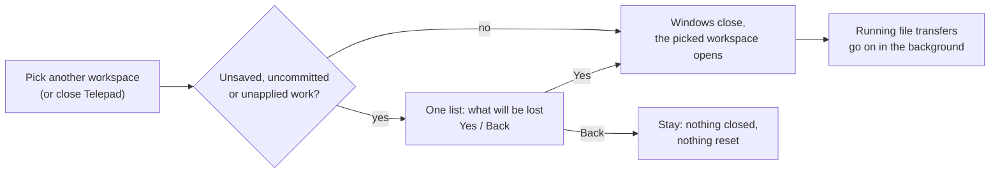

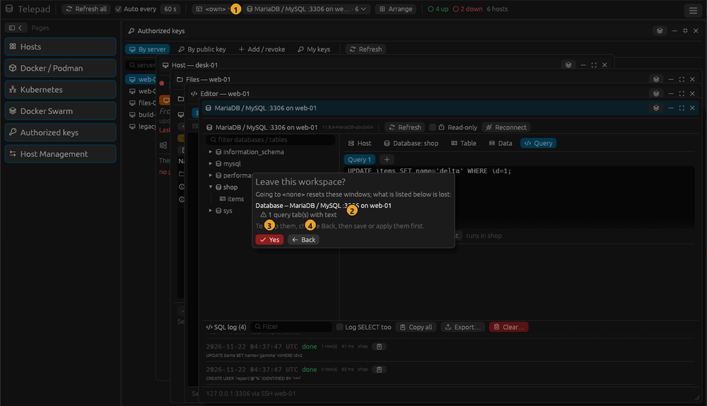

1. The **workspace** dropdown: picking another workspace (here `<none>`) starts the check.
2. What would be lost, grouped by window.
3. **Yes**: drop it and switch.
4. **Back** (or Escape): stay, nothing changes.

#### Before leaving: what is lost

Leaving a workspace resets its windows, so half-made changes never follow you into
another workspace where the same hosts, keys or settings may be edited again. When
something would be lost, **one question** lists it, window by window:

| Window | Listed when |
|---|---|
| File window / editor | editor tabs with unsaved text; an open New folder / Rename / Delete / Permissions dialog; a transfer waiting for your answer (overwrite question, rsync preview), which is cancelled |
| Database | grid changes not posted, structure editor changes not run, a new table or rename not done, SQL waiting for **Run**, query tabs with text, a connect form with a typed password |
| Host Management | changes not applied to either side, an open host form — the page reloads both sides when it comes back |
| Authorized keys | a pasted key, chosen servers, an add / revoke not confirmed — the form is empty when it comes back |
| Dialogs | the host editor, an import, changed Software update settings |

**Yes** drops all of it and goes to the other workspace. **Back** (or **Escape**) stays:
nothing is closed or reset, so you can save, post or apply first. Nothing is saved,
posted or applied for you. With nothing to lose, Telepad switches without asking.
Closing Telepad asks the same question; there, running file transfers are listed too,
because they stop when Telepad closes.

#### File transfers keep running

Uploads and downloads are never stopped by a workspace switch. A file window with
transfers running stays in the background: the status bar shows
"_N_ file transfer(s) running in the background", and opening the same host's files in
any workspace (or switching back) shows the window again with the transfers, their
progress and results. When the last transfer ends, the background window closes and the
status bar says so.

#### What comes back

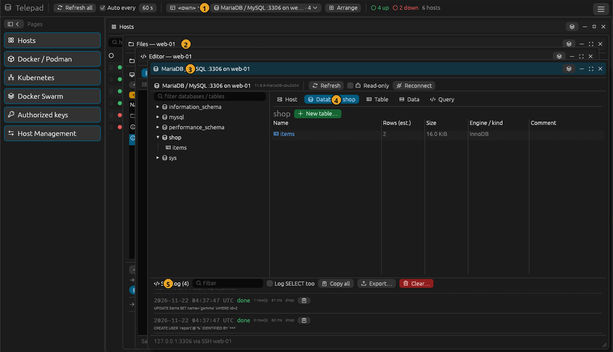

1. The workspace you came back to.
2. The file window, at its saved folders (its transfers still running).
3. The editor, with its files read again from the host.
4. The database window, connected again with the saved password, at its database.
5. Its SQL log, read back from `history.db`.

| Window | Saved | When it comes back |
|---|---|---|
| File window | the host, both folders | connects again (SFTP, else the fallback) and lists the saved folders. A folder that is gone shows the home folder with a note |
| Editor | its files (side and path only — never the text) | each file is read again from the computer or the host. A file that is gone or unreadable shows its error in its tab |
| Database | the connection (host, container or port, engine) and the database / schema | waits until its host has been checked, finds the database again (a container's address may change) and connects with the saved user and the password from the system's password store. Without a saved password it opens on the connect form. A database that is gone is left out, with a note in the status bar |
| Host window, pages | as before | as before |

A host that was deleted from the inventory is left out (note in the status bar); one that
cannot be reached opens its windows with the usual connect error and **Retry**.
Passwords, file contents and keys are never written to `preference.db`.

Workspaces are kept in **`preference.db`** next to `telepad.db` (another file with
`--prefs <path>` or `TELEPAD_PREFS`), apart from the host inventory. If it cannot be opened
(read-only folder, written by a newer Telepad), Telepad still starts with &lt;own&gt; = the
Hosts page and says in the status bar that workspaces are not saved.

Status dot: green = last check succeeded, red = it failed, blue = first check running,
grey = no result yet (or not monitored). Usage bars turn yellow and red as they fill; temperatures are blue
below 70 °C, yellow from 70 °C and red from 85 °C.

**Button colours**: a button's colour says what it does. **Red** (with the trash icon)
deletes, removes, drops, revokes or overwrites something; **yellow** edits or renames;
**green** adds or creates; **amber** opens a session that can change things (SSH, RDP).
Other buttons keep the neutral look. Each theme has its own
shades (deep fills with light text in the dark theme, brighter fills in the light theme),
and in menus the same meaning shows as red / yellow / green text.

**Copy and paste**: every text field (forms, filters, the Authorized keys box, database
queries, the file window's path bars, the editor) works with the system clipboard:
Ctrl+C / Ctrl+X / Ctrl+V (Cmd on macOS), in every window.

### Tables

Every table in Telepad works the same way (#153). There are two kinds: a **simple table**
shows all its rows (Disks, Network, Ports in use, sensors, Docker containers, cluster
tables, Groups / Clusters, Host Management, Authorized keys, My keys, the database lists);
a **paged table** has the pager footer under it (the database Data grid, Log info).

- **Sort:** click a column title: ascending, again descending, a third time back to the
  table's own order. Numbers sort by value, also with a unit (`5%` before `40%`, `980 MiB`
  before `1.5 GiB`, `5m ago` before `2h 5m ago`), addresses and names in natural order
  (`192.0.2.9` before `192.0.2.10`), empty cells always last.
- **Filter row:** a box above each column title. Text = contains (any case), `=x` equal,
  `!x` not equal, `>x` / `<x` greater / less (numbers by value, units understood: `>50`
  finds `75%`, `>1 GiB` finds `1.5 GiB`; dates as text, `>2026-11-20`), `NULL` empty,
  `!NULL` has a value. Hover a box for the rules. The database grid applies its boxes on
  Enter (on the server); the other tables filter while you type.
- **Right-click a row** for its menu: first the table's own commands (e.g. the host menu
  on the Hosts table, Edit / Set NULL / Copy value on the database grid, container actions
  on Docker tables, Revoke on Authorized keys), then for every table:
  - **Filter by *column*: *value*** puts the value of the cell you clicked into that
    column's box (long values are shortened in the menu; disabled on an empty cell);
  - **Clear All Filters** empties every box;
  - **Export as CSV…**, **Export as Excel (.xlsx)…**, **Export as PDF…** save the table
    to a file you choose (named `<table>-<date>-<time>.<ext>`, UTC);
  - **Copy as JSON** puts the rows on the clipboard as a JSON array (one object per row,
    keys = column titles).

  Exports take **every row the filters let through, in the shown order, from all pages**,
  not only the page on screen; columns that hold only buttons or icons are left out. CSV is
  UTF-8 with a BOM (Excel shows accents and symbols) and cells that look like a formula get
  a leading `'`; Excel files have a bold, frozen header with an autofilter and keep text as
  text (never a formula); the PDF is A4 (landscape when the table is wide) with the header
  on every page and page numbers. A PDF of more than 5000 rows asks first. The result (or
  the error) shows in the status bar. Right-clicking a column title offers Clear All
  Filters and the exports too.
- In the **database Data grid**, Export as CSV / Excel opens the Export dialog (all
  filtered rows from the server, #139); PDF and JSON take the rows loaded in the grid.

## Theme

**☰ → Settings → Theme** switches between **System** (follows the Windows / macOS / desktop
setting, the default), **Light** and **Dark**. The choice is saved in the database. The light
theme uses a grey background behind white windows with a border, and buttons and input
boxes with a visible fill and border, so every layer stands apart.

## Hosts

Telepad 0.9 has no host list on the left any more: the hosts are in **Overview — all
hosts** (table or cards). Click a host there to open its window; right-click for Edit /
Clone / Delete.

**Reorder hosts:** drag a host by its **⋮⋮** handle in the overview table and drop it on the
upper or lower half of another host; a line shows where it will land. The order is saved in
`telepad.db` at once, used by the table, cards and the generated ssh config, and kept after a
restart. The handles are hidden while the search box has text or a column is sorted.

## Overview

Click **Hosts** in the sidebar to see every host at once. The page header has the
**search box** (filters by host name, address, OS or container name) and the **View** switch:
**Table** or **Cards**; the choice is remembered. **By group** lists the hosts group by group
(in the order of the [Groups](#groups-and-clusters) page, ungrouped hosts last; the sort
applies inside each group) and shows the **Group** column; the **Group** and **Cluster**
boxes add those columns to the table. They last until Telepad closes.

## Groups and clusters

Hosts can be put into **groups** (e.g. *Office*, *Lab*) and, separately, **clusters**
(e.g. *Web*, *Storage*). Both are optional: a host is in at most one group and at most one
cluster, and the two do not depend on each other — one host can be in group *Office* and
cluster *Web* while another is in group *Lab* and the same cluster *Web*. These clusters are
your own labels; the [Kubernetes and Docker Swarm](#kubernetes-and-docker-swarm) pages show
the clusters Telepad finds on the hosts and do not change.

**Groups** and **Clusters** (sidebar, below My Computer) list them with their description and
how many hosts each has, how many are down and how many have flags. The last row, **Ungrouped**
/ **No cluster**, holds the hosts without one; it is fixed (no rename, no delete).

| Control | What it does |
|---|---|
| Search box | Filters by name or description |
| **Add group… / Add cluster…** | Name (one line, up to 64 characters, unique ignoring case; *Ungrouped* / *No cluster* are reserved) and an optional description |
| **⌃ / ⌄** | Moves it up or down (the order of the list, of **By group** and of the menus) |
| **Edit** | Rename or change the description; its hosts move along, and an open page follows the new name |
| **Delete** | Asks first; the hosts stay in Telepad without that group / cluster |
| Click a row | Opens **Hosts - [name]** |

**Hosts - [name]** is the Hosts page for that group or cluster only: search, Table / Cards,
sort, flags, a click opens the host, right-click for its menu. A group page shows each host's
**Cluster**, a cluster page its **Group**. **Add hosts…** lists the other hosts with their
current group / cluster: tick some and **Add** moves them here. These pages come back with the
[workspace](#workspaces) (saved as group:<name> / cluster:<name>).

Other ways to set a host's group or cluster: right-click a host ▸ **Group: …** / **Cluster: …**
(pick one, or *Ungrouped* / *No cluster* to take it out), or the **Group** / **Cluster** lists
in the host editor. Changing it reads nothing from the host again. Cards show the group and
cluster under the address.

### Docker / Podman

**Docker / Podman** (below **Hosts**) lists the containers of every host
grouped by stack (the compose project name), stacks A–Z, then **Standalone containers**;
hosts that run Podman are marked **(podman)**. A
stack running on several hosts appears once; inside it, each host has its own line with a
link to the host, how the stack is managed (docker compose folder or Portainer stack) and
the same **Compose** menu / **Open in Portainer** button as on the host page. Each container
shows image, status, container IPs and published ports, and its **☰** menu has the usual
[Docker actions](#docker-actions). Click a stack name to fold it. The search box filters by
stack, container, image or host.

### Kubernetes and Docker Swarm

**Kubernetes** and **Docker Swarm** in the sidebar list every cluster Telepad found on your
hosts, once each even when several managers report it, with the hosts it was reached from
(click one to open it). Each cluster shows the same panel as its host window: nodes,
workloads / services and stacks, problems in red, and the confirmed actions of
[Swarm and Kubernetes](#swarm-and-kubernetes). When no host reported a cluster the page
says so ("No Kubernetes cluster found on your hosts"). Nothing new runs on the hosts: the
pages use what the regular refresh collected.

### Table

One row per host: **Host**, **Description**, **Address**, **OS**, **Flags**, **CPU**, **Memory**,
**Fullest disk**, **Temp** (hottest sensor), **Docker** (running/total containers) and
**Updated** (age of the data). The row under the mouse is highlighted. Click a row (or the
host name) to open its host window. **Right-click** a row (or a card) for the host menu:
**Open SSH** (or **Open RDP**, amber), **Files** (yellow, the host's file window), the
**databases** Telepad found on the host and in its containers (MariaDB / MySQL / PostgreSQL),
then **Open host window**, **Edit**, **Clone** and **Delete…**.

**Column widths are automatic** and follow the page: open, resize, maximize or restore the
Hosts window (or collapse the page sidebar) and the columns fit again at once. Each column
gets what its values need; spare width goes to **Description**, **OS**, **Flags** and
**Docker**, so **Updated** stays as narrow as its text. When the page is too narrow, the long
text columns (Description, Docker, OS, Address, and Group / Cluster when shown) give way
first, then the bars (CPU, Memory, Fullest disk, Temp), and Host, Flags and Updated last; at
the minimum widths the table scrolls sideways. Flags use the normal text size; when a row's
flags do not fit, they show as their coloured icons only (never cut off) and hovering the cell
lists them all.

In inventory order (no column sorted, no search) each row has a **⋮⋮** handle in the first
column: drag it to reorder hosts. While a column is sorted or the
search box has text, the handles are hidden and a hint above the table says what to clear.

- **Sort:** click a column header. Numbers start with the highest (busiest CPU, fullest
  disk, hottest, most containers, most recently updated), text columns from A to Z; the
  arrow next to the header shows the direction. Click again to reverse, a third time to
  return to the inventory order. The unlabelled first column sorts by status (down hosts
  first). Addresses sort numerically (`10.0.0.9` before `10.0.0.10`), and hosts without a
  value for the column (no data yet, or unreachable) always stay at the bottom.
- **Resize:** drag the border between two column headers: that column keeps the width you
  gave it and the others make room. **Double-click** the border to put that column back to
  automatic; **right-click** a header ▸ **Auto-fit columns** puts all of them back. Widths you
  set last until Telepad closes. Text that does not fit is cut with "…"; hover over it to
  read all of it. Error messages stay inside the OS column. Sortable headers show a hand
  cursor; a click right on a border never sorts.
- The header row stays in place while you scroll; when the columns are wider than the
  window, scroll sideways.
- **Filter row and menu:** the boxes above the titles narrow the hosts by column (e.g.
  `>80%` under CPU, `down` under the status column); the right-click menu ends with
  Filter by, Clear All Filters, Export (CSV / Excel / PDF) and Copy as JSON — see
  [Tables](#tables). Rows cannot be dragged while a box has text.

The search box (in the Hosts and Docker / Podman page headers) filters both pages by host
name, address, OS or container name.

### Cards

One card per host, wrapping to the window width: status, OS logo, alias (click it for the
detail page), address and description, its group and cluster (when it has them), OS, CPU / RAM / fullest-disk bars, hottest
temperature, Docker summary, how long ago it was checked, and an **SSH** / **RDP** button.
Unreachable hosts show their error instead of the bars. The search box filters the cards;
**Sort by** picks the order (the same columns as the table, or inventory order) and the
arrow button next to it reverses it.

### Maintenance flags

The **Flags** column, the cards and the host's **Maintenance**
section show what needs doing on a host (hover for details):

| Flag | Meaning | Source on the host (read-only, offline) |
|---|---|---|
| red **EOL** | the OS release is past its vendor's end of support: no more security fixes | `/etc/os-release` `ID` + `VERSION_ID` against Telepad's built-in table |
| yellow **EOL 75d** | support ends within 6 months | same |
| yellow **reboot** | a reboot is pending (with the packages that asked for it) | `/var/run/reboot-required`, `needs-restarting -r`, or the running kernel older than the newest installed one |
| **⬇ 12 (3 sec)** | 12 package updates waiting, 3 of them security updates (red when there are security updates) | `apt-check` / `apt-get -s`, `dnf` / `yum check-update --cacheonly`, `apk` |

Update counts come from the host's local package cache, so they are only as fresh as the
host's last `apt update` / `dnf makecache`. Releases not in the table show "unknown"
support. Sort by **Flags** to see the most urgent hosts first.

## My Computer

**My Computer** (at the top of the page sidebar, above **Hosts**) is the host page of the
computer Telepad runs on. It needs no SSH and is not in the inventory, so it is never
exported, imported or written into `telepad.ssh_config`. It shows the same sections as a
[host](#host-detail): **System**, **Maintenance**, **Usage**, **Disks**, **Network**,
**Sensors**, **Docker** and **Ports in use**. A section this computer cannot fill says so.

- It is read when the page opens and then at the **live** interval of the
  [Update Strategy](#update-strategy) while the page stays open (not while everything is
  paused); **Refresh** reads it now. Reading is read-only and needs no administrator
  rights: on Windows from the system, `netstat -ano` (listening ports and their program),
  `reg query` (reboot pending) and the `docker` / `podman` command; on Linux and macOS
  the same script that runs on hosts, run locally.
- On Windows, temperatures are shown only to administrators, so **Sensors** usually says
  *not available*; pending updates are *unknown* (Windows Update is not asked).
- **Open Terminal** opens a shell of this computer in a new terminal window, in your home
  folder (Windows Terminal, else PowerShell; Terminal on macOS; the first terminal
  emulator found on Linux).
- **Open files…** opens a [file window](#files-upload--download--manage--edit) with
  **This computer** on both sides: two folders of this computer side by side, copied
  with **Copy to right** / **Copy to left**, F5 or drag and drop, with the same overwrite
  question, progress and history as for a host.
- **Open MariaDB / MySQL :3306**, **Open PostgreSQL :5432** appear when a database server
  listens on this computer; a database container that publishes its port here gets a
  database button in its row. They open the [database browser](#database-browser-mariadb--mysql--postgresql)
  on `127.0.0.1` directly, without SSH. A server that listens only on another address (or
  only on `::1`) is not offered.
- There is no **Copy ssh command**, **Edit**, **Clone**, **Delete**, **Log info** or
  Docker action on this page.

## Host detail

The header shows the status, OS logo, alias and `user@address`. Below it are the buttons
**Open SSH** / **Open RDP**, **Open files…** (see [Files](#files-upload--download--manage--edit)),
**Copy ssh command**, **Refresh**, then **Edit**, **Clone** and **Delete**, the database
buttons (**Open MariaDB / MySQL :3306** …, see [Database browser](#database-browser-mariadb--mysql--postgresql))
and **Log info** (SSH hosts, see [Log info](#log-info-ssh-logins)). On a narrow window the buttons (and the top bar) wrap onto a second line instead
of being cut off. Below that:

- **System**: OS, kernel, architecture, uptime, CPU model and cores, load average.
- **Usage**: CPU, Memory and Swap bars.
- **Disks**: every mount with size, used and free space.
- **Network**: interfaces and their IP addresses.
- **Sensors**: temperatures and fan speeds. Fans spin faster in the drawing the faster
  they run. On a physical server whose BMC is not readable yet, **Set up BMC access…**
  appears (see [Fan speeds and BMC temperatures](#fan-speeds-and-bmc-temperatures-ipmi)).
- Under the description: when the OS / CPU facts and the addresses / ports / updates were
  last read (see [Refreshing](#refreshing)).
- **Docker**: runtime version, management (for example a Portainer agent), compose
  stacks with their folder and file, and every container with image, state, container
  IP per network and published ports. See [Docker actions](#docker-actions).
- **Ports in use**: every listening port with the container or process that owns it
  (the process only when the login user may see it); **nginx only** narrows the list to
  the ports nginx serves.

## Log info (SSH logins)

**Log info** in a host's header opens a page (one per host, it comes back with the
[workspace](#workspaces)) listing who logged in to that host over SSH: when, as which user,
from which address, how (public key, password, keyboard-interactive) and with which key.
Telepad reads it from the host's systemd journal with one SSH call when the page opens and
on **Refresh**, never in the background rounds: `journalctl` **without sudo**, the sshd lines
of the last 30 days (newest 5 000 at most) and the login user's `~/.ssh/authorized_keys` to
name the keys. Nothing on the host changes. On a host with a very large journal (a public
SSH server collects close to a million attack lines a month) the read can take a minute or
two; it runs in the background (up to 3 minutes) and the rest of Telepad keeps working.

Above the table: the login user, how it reads the journal (`systemd-journal`, `adm`, `wheel`
or root), since when the journal holds entries (on hosts that keep the journal only since
the last boot this can be short: few rows does not mean few logins), the number of logins,
and **Telepad logged in as … with …**: the key sshd actually accepted for this read (its
journal line carries this session's process id). That key is also marked **last used by
Telepad** on the [Authorized keys](#authorized-keys-list-add-revoke) page.

The table (made-up example):

| Time (host) | User | From | Method | Key type | Key name | Telepad | Fingerprint |
|---|---|---|---|---|---|---|---|
| 2026-11-24 08:37:42 | alice | 192.0.2.10 | publickey | ED25519 | id_ed25519 — alice@pc (this PC) | this read | SHA256:Qm3x… |
| 2026-11-23 17:00:27 | bob | 198.51.100.7 | publickey | ED25519 | [developer] bob@example.com | | SHA256:7hZp… |
| 2026-11-23 09:12:03 | carol | 198.51.100.8 | password | | | | |

- **Time** is the host's own clock and time zone. **Key name** is the comment (with its
  `[group]`) from the login user's `authorized_keys`, else a key of this computer, else
  *unknown key* (a key in another user's file, or one removed since).
- **Newest first** by default. Click a header to sort ascending, again for descending, a
  third time for newest first again; empty cells stay last.
- One **filter** box above each column title: text = contains (any case), `=x` equal, `!x` not
  equal, `>x` / `<x` (numbers by value, times as text, e.g. `>2026-11-20`), `NULL` empty,
  `!NULL` not empty. **Clear filters** empties them all.
- **Pager** (footer under the table, it stays visible while the rows scroll): *Record [21 - 40]
  of 279*, then first / previous, **Page [n] of N** (type a page number and press Enter),
  next / last, and **Rows per page** (type a number and press Enter; 20 by default, empty
  = 100; more than 100 asks first because a long page is slow).
- **Show this PC's logins** (off by default): logins from this PC's address with a key
  Telepad logs in with. Telepad does not reuse connections, so every refresh round is one
  login (about 1 440 a day per host at the default 60 s, see [Update Strategy](#update-strategy));
  hidden, they do not bury other people's logins. Your own `ssh` from this PC with the
  same key is hidden with them.

**Journal access.** A normal user cannot read the system journal. When the login user
cannot, the page says so and shows **Register Systemd Journal**: it opens an SSH terminal
on the host that prints

```
sudo usermod -aG systemd-journal <login user>
```

and runs it after you press Enter; sudo asks for your password there (Telepad never
handles it). It takes effect on the next login, so click **Refresh** when the terminal says
*Done*. **Unregister** (shown while the user is in `systemd-journal`) does the same with
`sudo gpasswd -d <login user> systemd-journal`. Users in `adm` (Debian / Ubuntu) or `wheel`
(Fedora / RHEL) and root can already read the journal and need neither.

The group only **reads** logs: no root, and logs cannot be changed or deleted. But logs
can hold sensitive text (sudo command lines of other users, service output, addresses), so
give it only to the account Telepad logs in with.

| Distribution | Works | Notes |
|---|---|---|
| Debian / Ubuntu | yes | journal kept across reboots; `adm` can read it too |
| Fedora / RHEL / CentOS / Rocky / Alma | yes | the journal is often kept only since the last boot (until `/var/log/journal` exists); `wheel` can read it too |
| Alpine, BusyBox, NAS without systemd | no | *Journal not available on this host* |

From the command line: `telepad-check --logins <alias>` prints the same read (newest 15).

## Docker actions

Each container row has a **☰** menu, and each docker compose stack a **Compose** menu.
Telepad never changes a container by itself: every action opens a terminal on the host
that prints the exact command and runs it only after you press **Enter**. **Kill**,
**Remove** and compose **Down** ask you to type `yes`. If your user may not use Docker
directly, the command runs with `sudo` and sudo asks for your password there.

| Menu | Actions |
|---|---|
| Container ☰ | Shell (`docker exec -it`, bash if present), Logs (`logs -f --tail 200`), Start, Stop, Restart, Pause, Resume, Kill, Remove (`rm` without `-f`: stop it first; volumes are kept) — only the ones that fit the container's state |
| Compose | Logs, Up (`up -d`), Restart, Stop, Down (`down` without `-v`: named volumes are kept), run with the stack's own folder, project name and files |
| Portainer stack | **Open in Portainer** when the Portainer server runs on this host, otherwise "change it in Portainer": Portainer stacks are only changed in Portainer |

**How it runs…** (container ☰) reads `docker inspect` and the stack's compose files
(read-only) and shows a `docker run` command rebuilt from them, with **Copy** buttons.
Image defaults (environment, command) appear as options, and values whose name looks
like a secret (`PASSWORD`, `TOKEN`, `KEY`, …) or passwords inside URLs are shown as `***`.
Portainer keeps its stacks' compose files inside its own volume, so they are not shown.

Example (made-up container):

```
docker run \
  -d \
  --name shop-db \
  --restart unless-stopped \
  --network shop_default \
  -p 127.0.0.1:3307:3306 \
  -v shop_db:/var/lib/mysql \
  -e 'MARIADB_ROOT_PASSWORD=***' \
  mariadb:11
```

## Swarm and Kubernetes

When a host is a **Docker Swarm** manager, or can read a **Kubernetes** cluster with
`kubectl`, `k3s kubectl` or `microk8s kubectl` (its own kubeconfig, or `sudo -n` when
allowed), the host page gets a **Cluster** section and the overview's Docker cell a badge
(*Swarm manager*, *Swarm worker*, *k8s*).

- **Swarm**: nodes (status, availability, leader), services with replicas running /
  wanted, stacks, and tasks that should run but do not. Workers only show their role: the
  cluster can only be read on a manager.
- **Kubernetes**: nodes (ready), deployments, statefulsets and daemonsets with ready /
  wanted pods, and problem pods (not running, waiting such as `CrashLoopBackOff`, or
  restarted 5 times or more).
- A degraded cluster (node down, missing replicas, problem pods) raises a red
  **cluster** flag in the Flags column.
- Several managers of one cluster, or one machine under two aliases, show the cluster
  once; the others say "Same cluster as …" with a link.

Actions work like the [Docker actions](#docker-actions): a terminal shows the exact
command and runs it after you confirm.

| Where | Actions |
|---|---|
| Swarm service ☰ | Logs (`docker service logs -f`), Restart (rolling, `service update --force`), Scale… (the terminal asks for the number of replicas) |
| Swarm node ☰ | Drain, Pause, Activate (`docker node update --availability`) |
| Swarm stack ☰ | Remove stack (`docker stack rm`, type `yes`) |
| Kubernetes workload ☰ | Logs, Rollout restart, Scale… (not for daemonsets) |

Collection stays read-only, every cluster command has a time limit, and long lists are
capped (500 services, 1000 workloads per kind, 100 problem pods).

## Refreshing

All monitored hosts are checked at start, then by themselves as set on the
[Update Strategy](#update-strategy) page. **Refresh all** checks every host now;
**Refresh** on a host checks only that one. Pausing — all hosts or single hosts — is on the
same page: **Pause all** stops every automatic check until **Resume**, and a paused host is
not checked by itself (no SSH, no ping) and skipped by **Refresh all**, while its own
**Refresh** still reads it. The status bar says *Paused …* or *N hosts paused*; click it to
open the page.

Not everything is read on every round. By default automatic checks read:

| What | How often (default) |
|---|---|
| Ping (host up or down, no SSH) | every 30 s |
| Uptime, load, CPU, memory, disks, sensors, Docker, Swarm, Kubernetes | every minute |
| IP addresses, listening ports, pending updates, reboot needed | every 6 hours |
| Hostname, OS release, kernel, architecture, CPU model | once a day |

**Refresh** and **Refresh all**, a new or edited host and a host that has just rebooted
(uptime went down) read everything. When SSH fails, Telepad checks whether the machine is
up: ping first, and for hosts whose firewall drops ping a TCP connect to their SSH port
(opened and closed again, nothing sent). A host that answers either is tried over SSH again
on the next round. A host that answers neither is only checked on the following rounds (no
ssh connection, no timeout to wait for); as soon as it answers ping or its SSH port opens
everything is read again, and ssh is still tried after the SSH retry time (10 minutes by
default). Hosts reached through ProxyJump / ProxyCommand cannot be checked from this
computer: they are tried over SSH again on the next round after one failure, and wait for
the SSH retry time after two failures in a row. Remote Desktop hosts are always just ping +
port check.

Pending updates are what the host's own package lists say: Telepad never runs
`apt-get update`, `dnf makecache` or anything else that changes a host. A host refreshes its
lists itself (e.g. `unattended-upgrades`, `dnf-automatic`, or you).

### Last known info after a restart

OS and CPU info, addresses, listening ports and pending updates are kept in `update.db`
each time they are read. When Telepad starts, every host shows them at once — the
Hosts table says *last known: Ubuntu 24.04 LTS* until the host answers, and the host page
shows **Last known: …** and how old the info is (*OS and CPU info read 3h 10m ago*). They
are not read again before they are due, so a restart does not re-read every host's OS and
updates. A deleted or renamed host's saved info is dropped.

## Update Strategy

**☰ ▸ Update Strategy…** opens a page (an inner window that comes back with its workspace)
for everything about refreshing: pause all or single hosts, and what Telepad checks by itself:

```
Automatic checks are running.   [⏸ Pause all]
On  Check                            Reads                                         Every       Allowed
☑   Ping                             Host up or down, without SSH (RDP: probe)     30  [s  ▾]  10 s – 1 h
☑   Live metrics                     CPU, memory, disks, sensors, Docker, …        1   [min▾]  15 s – 1 d
☑   Network & updates                IP addresses, listening ports, updates, …     6   [h  ▾]  1 min – 7 d
☑   System info                      Hostname, OS release, kernel, CPU model       1   [d  ▾]  1 min – 7 d
    Retry SSH for unreachable hosts  Down hosts (no ping, SSH port closed) are only …   10  [min▾]  1 min – 1 d
[✓ Save]  [Revert]  [Reset to defaults]

Hosts
[search host, IP, OS]  [⏸ Pause 54 listed]  [▶ Resume 2 listed]   2 paused
    Host      Updated           Ping
●   web01     12s ago           3 ms      [⏸ Pause]  [⟳ Refresh]
●   backup01  ⏸ paused · 2h ago  —        [▶ Resume] [⟳ Refresh]
```

| Control | Does |
|---|---|
| **Pause all** / **Resume** | Stops / restarts every automatic check (SSH and ping) for all hosts. Saved, so Telepad starts paused after a restart if you left it paused. |
| **On** | Turn a check off: it never runs by itself (Refresh still reads it). The interval stays for when you turn it on again. Live metrics off still reads *Network & updates* and *System info* when they are due. |
| **Every** | Number and unit (s, min, h, d). Values outside **Allowed** are refused on Save with the reason. |
| **Save** | Checks and saves the form to `update.db`; applies from the next round, no restart. |
| **Revert** | Back to what is saved. |
| **Reset to defaults** | Puts the defaults in the form (ping 30 s, live 1 min, network & updates 6 h, system info 1 d, SSH retry 10 min); **Save** keeps them. |
| **Hosts** list | Every monitored host with its state, when it was last read and its last ping. **Pause** / **Resume** on a row pauses that host (saved in `update.db`, kept when the host is renamed, dropped when it is deleted); **Pause _N_ listed** / **Resume _N_ listed** do it for the hosts the search box lists; **Refresh** reads that host now. |

A host can also be paused from its host page (**Pause updates** / **Resume updates** next to
**Refresh**) and from its right-click menu. The Hosts table shows ⏸ in the *Updated* column
of a paused host; its last values stay on screen.

**Ping check.** Every monitored host is pinged on its own timer, without SSH, so the up /
down count moves between live rounds. A host that answered ping before and misses two pings
in a row is shown down at once (*no ping reply — the host looks down (ping check)*) instead
of waiting for an SSH timeout; when it answers again it is read straight away. Hosts whose
firewall drops ping are never marked down by the ping check. For a host that is down, the
ping check also tries its SSH port when ping gets no reply, so a host that drops ping comes
back as soon as SSH is listening; hosts that are up are only pinged (no extra connections in
their sshd log). The host page shows the last check (*ping 12 ms · 5s ago*, *no ping reply,
SSH port open · 5s ago*). Hosts behind ProxyJump / ProxyCommand are not ping checked.
Remote Desktop hosts get their usual ping + port probe on the ping timer.

If `update.db` cannot be opened the status bar says so; the defaults apply and changes last
until Telepad closes.

Up to 12 hosts are checked at the same time,
each with an 8 s connect timeout and a 40 s total timeout, so one slow host never holds
up the others. The window stays responsive while hosts load.

## Adding, editing and removing hosts

**Add host…** at the top of the [Host Management](#host-management-compare-with-an-openssh-config)
page (Telepad database side; sidebar → **Host Management**)
opens the editor and saves the host straight into Telepad:

| Field | Meaning |
|---|---|
| **Alias (Host)** | Name used in ssh and in Telepad: letters, digits, `.`, `_`, `-` |
| **Description** | Free text shown under the name |
| **Group**, **Cluster** | Optional; pick one made on the [Groups / Clusters](#groups-and-clusters) pages |
| **HostName / IP** | Address to connect to (empty = the alias itself) |
| **User**, **Port**, **IdentityFile** | As in an OpenSSH config; empty = ssh's defaults. For IdentityFile, the arrow next to the field lists the private keys found in `~/.ssh`; **Browse…** opens in `~/.ssh` (on macOS press Cmd+Shift+. in the dialog to see other hidden folders); typing `~/.ssh/id_ed25519` works too |
| **Access** | **SSH (monitored)** or **RDP only (Windows)** |
| **Monitored** | Untick to keep a host in the list (for SSH/RDP buttons) without polling it |
| **Other ssh options** | One `Keyword value` per line, e.g. `ProxyJump bastion`, `KexAlgorithms +diffie-hellman-group1-sha1` or `LocalForward 8080 127.0.0.1:80`; values are written to the ssh config exactly as typed (quote an argument yourself if it contains spaces) |

**Edit** changes a host, **Clone** starts a new host with the same User, Port and
IdentityFile, and **Delete** removes it after a confirmation. Right-click a host in the
list for the same actions. Every change regenerates `telepad.ssh_config` immediately.

**Windows servers without SSH:** with Access set to **RDP only**, Telepad never opens an
SSH connection to the host. It pings it and tests the RDP port (3389, or the Port you
set); the host is up if either answers. **RDP** opens Remote Desktop (`mstsc` on Windows).

### Remote Desktop settings

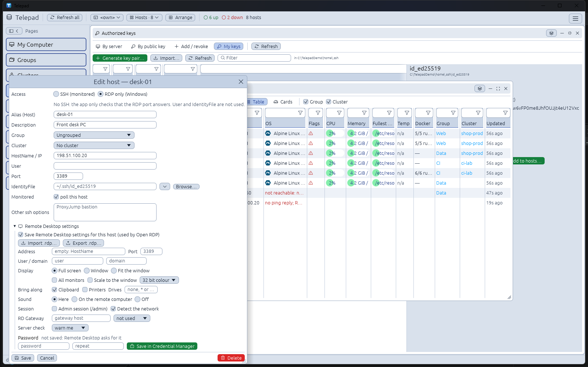

1. **Save Remote Desktop settings for this host** (untick to forget them).
2. **Import .rdp…** / **Export .rdp…**
3. **Display**: full screen, a window of a set size, or fit the window.
4. **Bring along**: clipboard, printers, drives.
5. **RD Gateway**, used always or when needed.
6. **Server check** and the note that no password is stored.

The editor's **Remote Desktop settings** section (open for RDP-only hosts, folded for SSH
hosts) keeps how Remote Desktop should connect, so **Open RDP** starts with them every
time. Tick **Save Remote Desktop settings for this host**; untick it to forget them.

| Field | Meaning |
|---|---|
| **Address**, **Port** | empty: HostName and 3389 (an RDP-only host's own Port) |
| **User / domain** | the login Remote Desktop fills in (`DOMAIN\user`) |
| **Display** | Full screen, a Window of a set size, or **Fit the window** (the remote desktop takes the window's size); **All monitors**; **Scale to the window** (`smart sizing`: the remote desktop keeps its size, e.g. 1920 × 1080, and is shrunk or stretched to fit); colour depth |
| **Bring along** | Clipboard, Printers, Drives (`*` = all, or letters such as `C:;D:`) |
| **Sound** | played here, on the remote computer, or off |
| **Session** | Admin session (`/admin`), network detection |
| **RD Gateway** | a gateway host, used always or only when needed |
| **Server check** | what Remote Desktop does when it cannot verify the server: warn, refuse, or connect |

**Import .rdp…** reads a file saved by Remote Desktop Connection (UTF-16 as `mstsc`
writes it, or UTF-8) into the section; lines Telepad has no field for are kept as they
are and listed under the section (**Drop them** removes them). A saved password in the
file is ignored. **Export .rdp…** saves the section as a `.rdp` file for another
computer. Settings travel with Telepad's JSON export / import, follow a renamed host and
go when it is deleted. They are never written to an OpenSSH config.

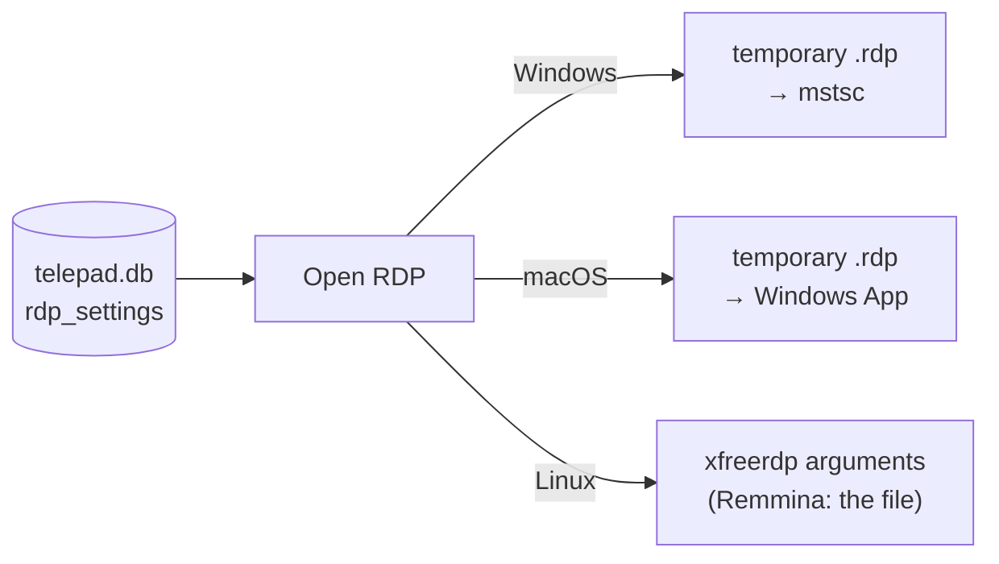

On Windows and macOS **Open RDP** writes a temporary `.rdp` file readable only by you,
starts the client with it and removes it half a minute later. On Linux the settings
become `xfreerdp` arguments; what `xfreerdp` cannot do (single drive letters, the server
check, extra lines) is named in the status bar. SSH hosts with saved settings get **Open
RDP** in their right-click menu too.

**Passwords**: Telepad stores none — not in `telepad.db`, not in the `.rdp` file. On
Windows the section has **Password** fields and **Save in Credential Manager**: Windows
keeps it as `TERMSRV/<address>` for the user (`DOMAIN\user`), exactly where Remote
Desktop's own *Remember me* puts it, so **Open RDP** logs in without asking. The section
shows whether one is saved; **Forget** removes it. Telepad never reads it back. On macOS
and Linux the client asks and keeps it in its own keychain.

When an SSH check fails, the error says whether the host still answers ping or has its SSH
port open, so a machine that is down looks different from one where only SSH is broken.

## Import and export

Import and export are at the top of the **Host Management** page, on the Telepad database
side (sidebar → **Host Management**): the **Import** menu and **Export…**.

- **Import → From ~/.ssh/config** imports your own OpenSSH client config in one click.
  To compare it host by host and copy changes in either direction, use
  [Host Management](#host-management-compare-with-an-openssh-config).
- **Import → From a file…** reads any file you pick:
  - an **OpenSSH client config** (any file that is not JSON);
  - **JSON** with a list of hosts: a Telepad export from any version, `{"hosts": [...]}`
    or a bare `[...]`. Common field names are understood, in any case and with or
    without `_`/`-`: `alias`/`name`/`host`, `hostname`/`ip`/`address`, `user`/`username`,
    `port`, `identity_file`/`key`, `description`/`note`/`comment`, `access` (`ssh`/`rdp`),
    `monitored`/`unmonitored`, and `options` as `[["Keyword","value"]]` or `{"Keyword":"value"}`.
    A host needs at least a name or an address.

  Either way a preview comes first:
  - **Merge — add new, update same alias, keep others**: new hosts are added at the
    end of the list in imported order; updated hosts keep their place.
  - **Replace — hosts become exactly this list**, in the order of the import.

  An import is all or nothing: if any host is invalid, nothing changes. Global
  `Host *` / `Match` blocks are imported too.
- **Import → From pasted text…** opens a text box: paste with Ctrl+V or
  **Paste from clipboard**, then **Next: preview**. It reads OpenSSH config text
  (`Host` blocks) or JSON as above, or a simple list with one host per line:

  ```
  web01 admin@192.0.2.10
  nas01 192.0.2.20:2222
  198.51.100.7
  ```

  that is `[alias] [user@]host[:port]` (without an alias the address becomes the
  alias; port 22 when none is given). Blank lines and `#` comments are skipped.
  Lines that cannot be read and invalid hosts are left out and listed with their
  line number in the preview; the other hosts can still be imported. If nothing
  can be read, the window stays open and says why.
- **Export…** writes `.json` (re-importable, keeps every field, with the groups and
  clusters and their descriptions) or OpenSSH config text. Hosts that are not monitored or
  RDP-only are marked with `# telepad: not monitored` / `# telepad: rdp only` comments,
  and a host's group / cluster with `# telepad: group <name>` / `# telepad: cluster <name>`,
  so they round-trip (JSON fields `group` / `cluster`; a name that does not exist yet is
  created on import).

`telepad.db` is a normal SQLite file: back it up by copying it while Telepad is closed,
or use Export. You can also inspect it with any SQLite tool.

## Host Management (compare with an OpenSSH config)

**Host Management** in the sidebar shows Telepad's hosts (database
icon, left) next to the hosts of an OpenSSH config file (monitor icon, right), so the two
can be kept in step in either direction. Nothing is written to either side until you click
**Apply** — except the buttons under **Telepad database**: **Add host…**, **Import**
(from a file, from `~/.ssh/config`, from pasted text) and **Export…** work at once, as
described in [Adding hosts](#adding-editing-and-removing-hosts) and
[Import and export](#import-and-export). (**Add to Telepad…** in the toolbar below is
different: it waits for Apply like every change in the list.)

**Which file:** `~/.ssh/config` at first. **File…** picks another file, **Folder…** a folder
(its `config` file is used); the choice is remembered. **Reload** reads the file again. A
file that does not exist yet counts as empty and is created on Apply.

**The list:** one row per alias, with

- **=** the same on both sides,
- **≠** different — the column on the right names the fields (HostName, User, Port,
  IdentityFile, Options, Description, Not monitored, RDP only, Group, Cluster),
- the database icon: only in Telepad; the monitor icon: only in the config.

**Filter** narrows the rows by alias, address or description; **Only differences** hides the
rows that are the same. Aliases defined together with others on one line (`Host jump
bastion`) or by a pattern are listed as **shared Host line**: they can be copied to Telepad,
but not changed in the file (do that by hand).

**Per host:** **→** copies Telepad's host to the config, **←** the config's host to Telepad;
the pencil edits the host on that side, the bin deletes it there; **↶** undoes the pending
changes of that host. Tick several rows to do the same for all of them (copy, delete, undo).

**All at once:**

- **Telepad → config** / **Config → Telepad**, each as **Merge** (add missing hosts, update
  different ones, keep hosts only the target has) or **Replace** (the target becomes a copy:
  hosts only the target has are removed; shared lines, `Host *` and `Match` stay).
- **Sync**: hosts only on one side are copied to the other; hosts that differ are marked
  red and you pick a side for each with → or ← before you can apply.

**Add to Telepad… / Add to config…** opens a small form (alias, HostName, User, Port,
IdentityFile, description, group, cluster, other options one per line, Not monitored, RDP only). Edits use
the same form. Hosts are checked like in the host editor.

Changed hosts are marked **pending** and counted at the bottom. **Discard** drops them.
**Preview and apply…** shows Telepad's changes and the config file as a diff (`-` removed,
`+` added); **Apply** writes them:

- Before the config is written, a copy is saved next to it as
  `config.telepad-YYYYMMDD-HHMMSS.bak` (UTC time). The file is replaced in one step and
  keeps its permissions.
- Only the blocks of the hosts you changed are rewritten. Comments, `Include`, `Match`,
  `Host *`, shared lines and the order of everything else stay as they are; new hosts go
  after the last host block, before `Host *` / `Match`. Telepad's description and its
  "not monitored" / "rdp only" marks and the group / cluster are written as `#` comments, as by Export.
- If the file was changed by something else since it was loaded, Apply stops: click
  **Reload** (your pending changes stay) and look at the preview again.
- Telepad's changes are saved in one transaction; a renamed host keeps its place in the list.

## Files (upload / download / manage / edit)

**Open files…** in a host's window (or **Files** in the sidebar) opens a file window, WinSCP style: **This computer**
on the left, the host on the right. It logs in as the host's normal SSH login (the same
user and key as **Open SSH**); nothing has to be installed on the host. Several file
windows can be open at once, one per host.

- **Top bar**: the host and `user@address`, then how files are copied:
  - **SFTP** — the normal case (the host's `sftp-server`, which every OpenSSH server has
    unless it was switched off).
  - **⚠ no SFTP on the host: copies with scp** — the host has no SFTP server. Telepad then
    lists folders with a small read-only `sh` script and copies with `scp -O`. There is no
    overwrite question and no progress bar in this mode: scp replaces files of the same name.
  - **Hidden files** shows names starting with `.`.
  - **Use rsync** — only shown when rsync is installed both on this computer and on the
    host (otherwise the reason, for example *rsync is not installed on this computer*).
- **Panes**: each has **Up**, **Home** and **Refresh**, the folder path (type a path and
  press Enter to go there; on this computer `~` is your home folder) and a filter box that narrows the list
  by name. The columns are Name, Size, Modified (UTC) and Permissions, plus Owner on the
  host side; click a header (anywhere in it) to sort, click it again to reverse. Folders are listed first.
  - Click anywhere on a row (icon, name, size, date, permissions) to select it; Ctrl+click
    adds or removes rows, Shift+click selects every row from the one clicked last. The pane
    title shows how many are selected. The **..** row can be highlighted too, but it is
    never copied, deleted or changed.
  - Double-click a folder (or **..**) to open it; drag any part of a row to copy it. A link
    or junction opens at the folder it points to (the path bar shows that folder): Windows' old
    `My Documents`, `Application Data` … junctions open `Documents`, `AppData\Roaming` ….
  - On this computer, files and folders Windows marks hidden or system are shown only with
    **Hidden files**, as in Explorer.
  - Both folders are remembered per host for the next time the window opens.
- **Copy** the selected files and folders (folders with everything in them):
  - **Upload** (local → host folder) or **Download** (host → local folder), or
  - **F5** copies the selection of the pane you clicked last to the other pane, or
  - drag the files onto the other pane.
- **The file exists**: when a file is already there, Telepad shows both sizes and times and
  asks **Overwrite**, **Skip**, **Newer only** (overwrite only when the copied file is
  newer) or **Cancel transfer**. Tick **Apply to all … existing file(s)** to answer once for
  the whole transfer.
- **Transfers** (bottom): every copy, newest first, with a progress bar (bytes done, speed,
  current file) and **Cancel**. A finished row says how many files were copied, skipped
  or failed; failures are listed under **error(s)**. **Clear finished** removes the
  finished rows.

Files are written next to their target as `<name>.telepad-part` and renamed only when
complete, so a cancelled or failed copy never leaves half a file in place of a good one.
Copied files keep their modified time (so **Newer only** works the next time). On the host,
new files get the permissions the host's umask gives them; Telepad never runs `sudo`, so
only folders the login user may write to can be changed.

**rsync**: with **Use rsync** ticked, Upload / Download first run `rsync --dry-run` and list
what would change (*rsync would change N path(s)*); **Run rsync** then copies them. rsync
copies only what differs and never deletes anything on the other side.

### Managing files

Each pane has a toolbar under its path, and the same actions on the right-click menu of a
row (right-clicking a row that is not selected selects it first). The keys act on the pane
you clicked last, never while you are typing in a field.

| Action | Toolbar / menu | Key | What it does |
|---|---|---|---|
| Edit | **Edit** | F4 | One selected file opens in the editor (see [Editor](#editor)); double-clicking a file does the same. |
| New folder | **Folder** | F7 | Asks for a name and creates the folder in the pane's folder; it is selected afterwards. |
| New file | **File** | | Creates an empty file. |
| Rename | **Rename** | F2 | One selected item, in the same folder. An existing name is never replaced. |
| Delete | **Delete** | Del | The selected items, folders with everything in them. |
| Properties | **Properties** | | One selected item: full path, type, size (for a folder: what is inside), modified time, permissions and owner. |
| Permissions | **Permissions** (host side only) | | See below. |
| Copy path | **Path** / **Copy path** | | The full paths of the selection (one per line), or the folder's path when nothing is selected. |

- **Names**: a name is one part of a path. Empty names, `.`, `..`, `/`, control characters
  and leading or trailing spaces are refused (on Windows also `\ < > : " | ? *` and a final
  dot). The reason appears in the dialog, which stays open so you can fix the name; so does
  *… already exists*.
- **Delete** asks once, listing every item with its size; for a folder it counts what is
  inside (*2.4 MiB in 12 file(s) and 3 subfolder(s)*), then shows the total. It says that the
  delete cannot be undone: the host has no recycle bin, and on this computer the files are
  deleted, not moved to the Recycle Bin. Links are removed themselves; what they point to
  is never touched.
- **Permissions…** (host side, one or more items): the current mode as checkboxes (owner /
  group / others × read / write / execute) and as an octal number (`644`, `2775`); either
  one updates the other. **Also everything inside the folders** applies it to what is
  inside too: folders get the mode plus *x* wherever *r* is set (so they stay openable),
  files get its read / write bits, keep *x* only if they already had it, and never get
  setuid / setgid / sticky. Links are not changed. The permissions column shows setuid /
  setgid / sticky as `s` / `t`, like `ls -l`.
- **Errors**: when some items cannot be deleted or changed (for example *Permission
  denied*), the others are still done and a red list at the top of the window names each
  failed item; **Dismiss** hides it.
- Telepad never uses `sudo` here: only what the login user may change is changed.
- On a host **without SFTP** the host side's actions are disabled (*Needs SFTP on the
  host*); copying and this computer's side still work.

### Compare, Synchronize, Diff and Transfer settings

The top bar of a file window has four tools that work between the two panes:

- **Compare** marks every entry of both panes against the same name in the other pane:
  a plus: only on this side (green); an up caret: newer on this side (blue), with a grey
  down caret on the older copy; not-equal: same time but another size (amber); equals: the
  same (grey). Times within 2 seconds count
  as the same. **Hide identical** leaves only what differs; clicking **Compare** again
  shows the plain lists. It compares the two folders shown, not the folders inside.
- **Synchronize…** makes one folder match the other:
  - **Left → right**, **Right → left** or **Both ways (newer wins)**;
  - **Also the folders inside (recursive)**; without it only the files of the two folders;
  - **Delete files the source does not have** (off by default, not for both ways).
  **Preview** compares the folders and lists every copy (→ / ←, *copy* or *replace*) and
  every delete (in red) before anything happens; **Synchronize** then runs exactly that:
  one transfer each way in the transfer panel (existing files are replaced without a
  question, the preview showed them) and the deletes, all in the history. One way without
  *New and updated files only*, a file that differs is copied even when the target is
  newer. Links are never followed or copied; folders in **Exclude folders** stay out.
  Needs SFTP on the host.
- **Diff** opens a file of each pane side by side in the [editor](#editor), like a git diff:
  lines only in the left file are red with a **-** in the gutter (deleted), lines only in the
  right file green with a **+** (added), equal lines in the normal colours; a changed line
  shows as **-** on the left and **+** on the right. The bar counts *n added, m deleted*.
  **Sync scroll** (on by default) keeps the two sides at the matching lines while you
  scroll either one. Select one file in each pane, or one file whose name is also in
  the other pane. Both sides can be edited and each has its own **Save** (with the usual
  changed-on-disk check); **Close compare** goes back to normal tabs. Binary files and
  files over the editor's size limit say so instead.
- **Transfer settings…** (kept per host): 
  - **Mode**: **Default** copies known text files (`.txt`, `.conf`, `.sh`, `.php`, `.json`,
    `Dockerfile` …) as text and everything else as is; **Text** copies every file as text;
    **Binary** never changes a byte. As text, line endings become the target's: CRLF on
    this computer when it runs Windows, LF on hosts. A file with a NUL byte or over 64 MiB
    is always copied as is. scp and rsync always copy bytes as they are.
  - **New and updated files only**: an existing file is replaced only when the copied one
    is newer, without the overwrite question (rsync: `--update`).
  - **Exclude folders**: names or patterns with `*` and `?`, separated by `;` (for example
    `node_modules; .git; dist`); such folders are never copied, also inside copied folders
    (rsync: `--exclude`).
  They apply to Upload / Download, drag and drop, F5 and Synchronize.

### Transfer history

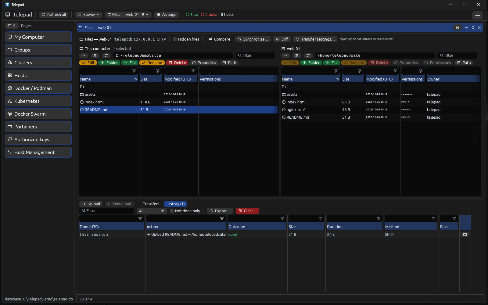

1. **History (_n_)** next to **Transfers**.
2. **Filter**, **All / Uploads / Downloads**, **Not done only**.
3. **Export…** (CSV of the lines shown) and **Clear…**.
4. One line per action: time (UTC), what → where, result, size, duration, method.
5. Show the local folder of a transfer in the file manager.

The transfer panel at the bottom of a file window has two tabs: **Transfers** (what runs
now) and **History (_n_)**: everything Telepad copied or changed on this host, also in
earlier sessions — newest on top.

| Line | Shows |
|---|---|
| Uploads / downloads | time (UTC), direction, what → where (hover for every path), done / failed / cancelled, size, duration, method (SFTP, `scp -O`, rsync), skipped and failed files with the reason |
| File operations | New folder / New file, Rename, Delete (each path), Permissions (mode), editor **Save**; "(this computer)" for the local side |

**Filter** (any words), **All / Uploads / Downloads**, **Not done only** (failed and
cancelled), **Export…** (the lines shown as CSV; a text cell starting with `=`, `+`, `-`
or `@` gets a leading `'` so a spreadsheet shows it instead of running it as a formula), **Clear…** (asks first; this host's
lines only). The folder button of a transfer line shows its local folder in the system's
file manager.

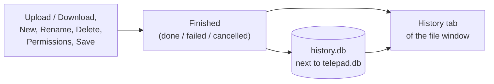

The history is kept in **`history.db`** next to `telepad.db` (`--history <path>` /
`TELEPAD_HISTORY` for another file): the last 90 days, at most 50 000 lines (older ones go
when Telepad starts). It holds paths, sizes and results only — never file contents,
passwords or keys. If the file cannot be written, Telepad says so in the status bar and
keeps working without history.

### Editor

**Edit** / F4 or a double-click on a file opens it in the host's **Editor** window, which
looks and works like VS Code. One editor window per file window: each file is a tab, files
of this computer and of the host side by side (the tab's icon says which; hover it for the
full path). Opening a file that already has a tab switches to it.

- **Refused files** show the reason in their tab instead of the text: binary files, files
  that are not UTF-8 text, and files over 10 MiB (download them instead). **Close tab**
  closes it.
- **Look**: light or dark with Telepad's theme, line numbers, the line with the cursor
  highlighted, monospace font, colours by language. The language comes from the file name
  (`.sh`, `.yml` / `.yaml`, `.json`, `.toml`, `.ini` / `.conf` / `.cnf`, `.env`, `Dockerfile`,
  nginx files (`nginx.conf`, files under `/nginx/`), `.py`, `.js`, `.ts`, `.php`, `.sql`,
  `.md`, `.rs`), else from a `#!` first line (`#!/bin/sh`); the status bar's language menu
  changes it. Files over 2 MiB are shown without colours.
- **Tabs**: a tab with changes that are not saved shows **●**; **×** (or a middle click,
  or Ctrl+W) closes it.
- **Status bar**: *Saved* / *Not saved* / *Saving…*, then `Ln 12, Col 5` (and how many
  characters are selected), the indentation (*Spaces: 2* or *Tab*, from the file), the
  language, the line endings (**LF** or **CRLF**) and the encoding (**UTF-8**, or **UTF-8 with
  BOM**).

| Key | Does |
|---|---|
| Ctrl+S | Save (also the **Save** button) |
| Ctrl+Z / Ctrl+Y (Ctrl+Shift+Z) | Undo / redo, per tab |
| Ctrl+F | Find (a selection on one line becomes the search text) |
| Ctrl+H | Replace |
| Ctrl+G | Go to line |
| Enter / Shift+Enter, F3 / Shift+F3 | Next / previous match |
| Esc | Close the find bar, back to the text with the match selected |
| Tab / Shift+Tab | Indent / outdent the selected lines (one line: Tab inserts at the cursor) |
| Ctrl+W | Close the tab |

- **Find / replace**: **Aa** match case, **ab** whole word, **.\*** regular expression;
  every match is highlighted, the current one stronger, with *3 of 12*. **Replace** replaces
  the current match and goes to the next; **Replace all** replaces every match (*12
  replaced*). With **.\*** the replacement may use `$1`, `$2`… for the groups (`$2_$1` swaps
  `APP_ENV` to `ENV_APP`; `$$` is a `$`). An invalid expression says why in red.
- **Line endings and encoding are kept**: a CRLF file is saved with CRLF, an LF file with LF,
  a byte order mark stays, and so does the presence or absence of a newline at the end. A
  file with both kinds of line endings is saved with the more common one (hover **CRLF** /
  **LF** to see it).
- **Saving** writes the text to `<name>.telepad-part` next to the file, gives it the file's
  permissions (and owner, when the login may set it), then puts it in place of the file:
  a failed save never leaves half a file. A link is followed: the file it points to is
  saved, the link stays. If the folder cannot be written, the red line under the path says
  so (*Cannot write a temporary file in /etc: Permission denied*); the text stays in the tab.
- **Changed meanwhile**: before writing, Telepad checks that the file's size and time are
  still what it loaded. If someone changed it on the host (or another program on this
  computer), a yellow box says so with its size and time now:
  - **Overwrite** — save your text anyway;
  - **Reload** — discard your changes and load the file as it is now;
  - **Show diff** — the lines that differ (`−` in the file now, `+` your text, unchanged
    runs folded);
  - **Keep editing** — close the box (Save asks again).
- **Unsaved changes**: closing a tab, the editor window, the file window or Telepad itself
  while a tab has changes asks first: **Save** (the window closes when the saves are done;
  a save that fails keeps it open), **Don't save**, or **Cancel**. When Telepad itself was
  closing, close it again after answering.
- Editing on the host needs SFTP: on a host without it, only this computer's files open.

## Authorized keys (list, add, revoke)

**Authorized keys** in the sidebar shows who can log in to
your hosts with an SSH key, and gives someone SSH access to many hosts at once, or takes it
away, using the access Telepad already has. It reads and changes only the
`~/.ssh/authorized_keys` file of the user Telepad logs in as on each host (no `sudo`).

When the page opens, Telepad reads that file on every SSH host (read-only, in parallel);
**Refresh** reads them all again, the small ↻ next to a server only that one. The page has
four tabs; the last one, **My keys**, is about the keys on this computer (see
[My keys](#my-keys-this-computer)).

**Groups.** A `#` comment line names the group of the keys below it, until the next comment
line (blank lines do not end a group; with several comment lines in a row, the last one is
the name). Keys with no comment above them are in **No group**, so you can see which keys
are not grouped yet. Example (made-up keys):

```
ssh-ed25519 AAAA…  backup-job          ← No group
# maintainer
ssh-ed25519 AAAA…  ana@example.com     ← maintainer
ssh-ed25519 AAAA…  budi@example.com    ← maintainer

# developer
ssh-ed25519 AAAA…  citra@example.com   ← developer
```

- **By server**: the servers on the left with their number of keys (**no file** when there
  is no `authorized_keys`, **failed** with the reason on hover when the host could not be
  read). Pick one to see its keys: type, comment, SHA256 fingerprint and options
  (`from=`, `command=` …). The key Telepad itself logs in with is marked
  **Telepad logs in with this key** and cannot be revoked (also when only the private key
  file exists: Telepad then reads the public key from it). After the host's
  [Log info](#log-info-ssh-logins) page was read, the key sshd actually accepted for
  Telepad is marked **last used by Telepad**. A red **Revoke** removes that key
  from this server; the green **Add key** opens Add / revoke with this server ticked. Keys
  are shown under their group headings when the file has groups. The yellow **Edit file**
  opens the server's `~/.ssh/authorized_keys` in the [editor](#editor) (its file window
  connects first if needed), with a warning that removing or breaking the key Telepad logs in
  with locks you out; it is written only when you click **Save**, and the list is read again
  after saving.
  Older key types (e.g. `ssh-dss`) are listed but not managed; lines that are not keys are
  counted and left alone.
- **By public key**: every key found, grouped by fingerprint, with its comments, its
  group(s) and the number of servers that have it (the filter also matches group names). Click it to see those servers, each with a red
  **Revoke**, and **Revoke on all _N_ servers** (not the servers Telepad logs in to with
  it). The green **Add to server…** opens Add / revoke with the key filled in, to tick more
  servers.
- **Add / revoke**: the form below. Every shortcut above opens it with the key and the
  servers filled in and the confirmation waiting; nothing changes until you type the word.

After a run, the changed servers are read again, so the lists show the result.

1. Paste one public key (Ctrl+V): the single line from a `.pub` file, for example
   `ssh-ed25519 AAAAC3Nza… alice@example.com`. Telepad shows its type, its SHA256
   fingerprint (the same as `ssh-keygen -lf`) and its comment, or why it is not a valid
   key. Private keys, several lines and keys with options (`from=`, `command=`) are refused.
   **Group (for Add)**: type a group name or pick one found on your hosts. Add puts the key
   at the end of that group's block, or at the end of the file under a new `# name` line
   when the group does not exist yet. Empty: the key goes before the first comment line
   (or at the end when there is none), so it stays in **No group**. Revoke ignores it.
2. Tick the hosts. **Select all** ticks every host the filter shows (click again to clear
   them); the filter box narrows the list by name, address, description or OS. RDP-only
   hosts are listed but cannot be ticked. The number of selected hosts is shown.
3. Click **Add key** or **Revoke key**. Telepad lists the key and every selected host;
   type `add` or `revoke` and press Enter (or the button) to start, or **Cancel**.
4. The hosts are done in parallel; each shows its result:
   - **added** / **already present (not changed)** for Add,
   - **removed** / **not present (not changed)** for Revoke,
   - **refused** — an RDP-only host, or the key Telepad itself logs in with (revoking it
     would lock Telepad out of that host),
   - **failed** with the reason (host down, `~/.ssh` not writable, …).

   The status bar sums it up when all hosts are done.

Add creates `~/.ssh` (mode 700) and `authorized_keys` (mode 600) when they are missing
and never adds a key twice. Revoke removes every line with that key, whatever its comment
or options. Other lines are never touched, and the file is rewritten through a temporary
copy, so a failure leaves it as it was.

### My keys (this computer)

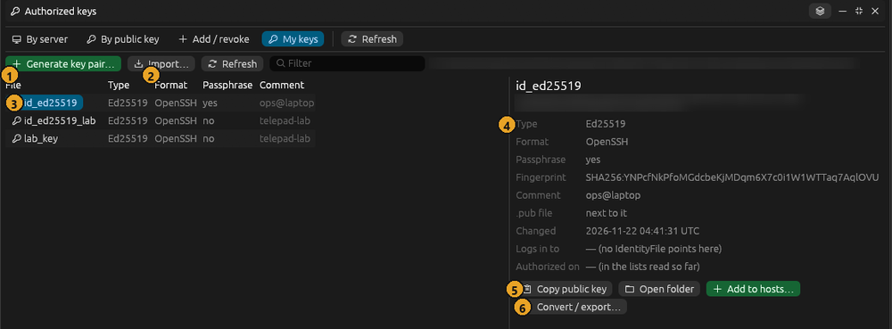

1. **Generate key pair…**
2. **Import…** a key file in another format.
3. The keys found (click one).
4. Its details: type, format, passphrase, fingerprint, comment, which hosts use it.
5. **Copy public key**, **Open folder**, **Add to hosts…**
6. **Convert / export…**

The **My keys** tab lists the key pairs on this computer: every private key in `~/.ssh`
and every **IdentityFile** of your hosts (one that is missing is listed with the reason).
`known_hosts`, `config`, `authorized_keys`, `.pub` and other files that are not keys are
skipped. Nothing on this tab runs on a host.

| Column / field | Shows |
|---|---|
| File, Type | the file name; Ed25519, ECDSA P-256 / P-384 / P-521, RSA with its size, DSA (legacy) |
| Format | OpenSSH, PuTTY PPK v2 / v3, PEM (PKCS#1 / SEC1), PKCS#8 (plain / encrypted), DER, PKCS#12, JWK, OpenPGP |
| Passphrase | whether the file needs one to be used |
| Detail (right) | path, fingerprint (`SHA256:…`, as `ssh-keygen -lf`), comment, whether the `.pub` is next to it, when it changed, which hosts **log in** with it (IdentityFile) and where it is **authorized** (from the lists of this page), a warning when others can read it (macOS / Linux) |

Buttons for the selected key: **Copy public key** (only the public line ever goes to the
clipboard), **Open folder**, **Add to hosts…** (opens **Add / revoke** with the key filled
in — you still pick the hosts and type `add`), **Convert / export…**.

**Generate key pair…** makes a new pair with the system's `ssh-keygen`:

| Field | Default |
|---|---|
| Type | **Ed25519** (also ECDSA P-256 / 384 / 521, RSA 2048–8192, default 4096) |
| File | `~/.ssh/id_ed25519` — or `id_ed25519_2`, `_3` … when that name is taken; the name follows the type until you change it |
| Comment | `you@this-computer` |
| Passphrase | empty is allowed, with a warning; type it twice |

An existing file is never overwritten. The passphrase never appears on a command line:
`ssh-keygen` writes the key into a private folder in `~/.ssh`, Telepad encrypts it there,
narrows its permissions there (Windows: your account by its SID, so domain and
Microsoft accounts work too), then moves `id_…` and `id_….pub` into place. If the
permissions cannot be narrowed, the key is still created and the status bar says so. The private key is readable by your user only
(Windows: your account, plus SYSTEM and Administrators as `ssh-keygen` sets them;
macOS / Linux: mode 600, `~/.ssh` 700).
Without `ssh-keygen` (Windows: the *OpenSSH Client* optional feature) the dialog says what
to install.

**Convert / export…** writes the key in another format, as a **new file** you choose (the
source is never changed):

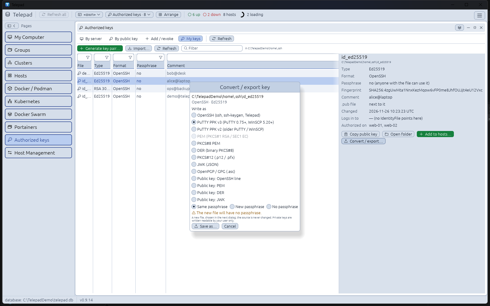

1. The passphrase of the key, when it has one.
2. The format to write (here PuTTY PPK v3).
3. Greyed out: this key type has no such form (hover for the reason).
4. Keep the passphrase, set a new one, or none.
5. **Save as…** opens the save dialog; the result is shown in green.


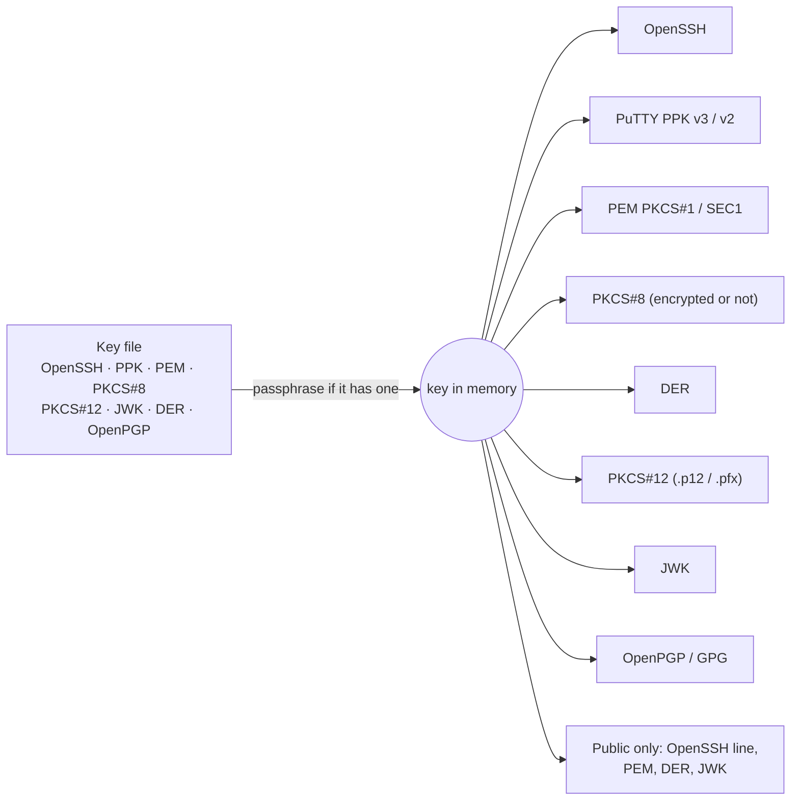

| Target | Key types | Passphrase |
|---|---|---|
| OpenSSH | all | keep, new or none |
| PuTTY PPK v3 (PuTTY 0.75+, WinSCP 5.20+) / v2 (older) | Ed25519, ECDSA, RSA, DSA | keep, new or none (v3: Argon2id, v2: AES as PuTTY does) |
| PEM | RSA (PKCS#1), ECDSA P-256 / P-384 (SEC1); not Ed25519 | none (written in clear, with a warning) |
| PKCS#8 | Ed25519, RSA, ECDSA P-256 / P-384 | keep, new or none |
| DER | as PKCS#8 | none |
| PKCS#12 | as PKCS#8 (key only, no certificate) | required |
| JWK | Ed25519, RSA, ECDSA P-256 / P-384 | none |
| OpenPGP / GPG (`.asc`) | Ed25519, RSA (a v4 key that signs and certifies, with the **User ID** you type, e.g. `Name <mail@example.com>`) | keep, new or none |
| Public key only | all of the above | — |

A format that cannot hold the selected key is greyed out; hover it for the reason. An
encrypted key asks for its passphrase first; a wrong one says so. Private output files are
readable by your user only; an OpenSSH result gets its `.pub` next to it. **Import…** opens
a key file from anywhere (for example a PuTTY `.ppk` from an old computer) in the same
dialog, with OpenSSH as the target, so `ssh` and Telepad can use it. Telepad's PuTTY files
were checked against PuTTY's own `puttygen` (0.83), both ways.

OpenPGP (GPG) secret keys — armoured `.asc` or binary `.gpg` — are read too (Ed25519
and RSA primary keys), so **Import…** turns them into OpenSSH keys; their User ID
becomes the comment. Telepad's OpenPGP output was checked with GnuPG 2.4.7: it imports
it, exports the same SSH key and signs with it. Old PEM files encrypted with
`Proc-Type: 4,ENCRYPTED` need `ssh-keygen -p -f <file>` once.

## Database browser (MariaDB / MySQL / PostgreSQL)

Telepad opens the databases it already sees, HeidiSQL style, through the SSH login it
already uses: no database port is opened to the network and no tunnel or client has to
be set up by hand.

**Where the button is**

- A running container whose image is MariaDB, MySQL, Percona or PostgreSQL (also
  `bitnami/postgresql`, PostGIS, TimescaleDB): its **☰** menu (host detail → Docker, and
  Overview — Docker) has **Open database…**. Tools such as exporters, phpMyAdmin,
  Adminer and pgAdmin are not offered.
- A database installed on the host itself (`mysqld` / `mariadbd` / `postgres` in the
  listening ports, or port 3306 / 5432 with no visible owner that no container
  publishes): the host detail header shows **Open MariaDB / MySQL :3306** or
  **Open PostgreSQL :5432**.

Each database opens in its own window inside Telepad. Opening the same one again does nothing while
its window is open.

**Connect**

The window starts with the connect dialog (like HeidiSQL's session manager):

- **User**, **Password**, **Database** (optional; PostgreSQL uses `postgres` when empty).
  For a container the user is filled in from its `MARIADB_USER` / `MYSQL_USER` /
  `POSTGRES_USER`; only that name is read (the filtering happens on the host, so
  passwords in the container's environment never leave it).
- **Save password in the system password store**: Windows Credential Manager, macOS
  Keychain, or the Linux Secret Service (GNOME Keyring on Ubuntu and CentOS / RHEL
  desktops, KWallet on KDE). With a saved password, leave the field empty. When no store
  is available (e.g. a Linux desktop without a keyring) the box is disabled and the
  password is asked for each time. Passwords are never written to `telepad.db` or any
  other file.
- **Read-only** (off by default): the server refuses changes from this window, and only
  `SELECT`, `SHOW`, `DESCRIBE`, `EXPLAIN` and `WITH` run in the Query tab. It can be
  switched on and off at any time from the toolbar and is remembered per connection.
- **Connect** opens `ssh -N -L` to the container's address on its Docker network (or to
  the address the host database listens on) and logs in. User, database and the switches
  are remembered. **Forget saved connection** deletes them and the saved password.

If the SSH server does not allow port forwarding (`AllowTcpForwarding no`) or the host
cannot reach the database address, the dialog says so.

**The window**

- Toolbar: **Refresh** (database list and the open database), **Read-only**,
  **Reconnect** (close the connection and log in again, e.g. after the network dropped).
- Left: the tree. MariaDB / MySQL: databases → tables and views. PostgreSQL:
  databases → schemas → tables and views. Click a database or schema to load it, a table
  to open it; right-click for **Open data**, **Structure**, **New table…**,
  **Empty (TRUNCATE)…** and **Drop…**. The box on top filters by name.
- Tabs:
  - **Host**: server version, databases with their size.
  - **Database**: tables of the chosen database / schema with estimated rows, size,
    engine or kind and comment; **New table…**.
  - **Table**: columns (name, type, length / set, unsigned, NULL, default, extra,
    comment), indexes, foreign keys, and for MySQL the CREATE statement.
  - **Data**: the rows (see below).
  - **Query**: SQL (see below).
- The status line at the bottom shows the last error or success.

**Data tab**

- **Filter boxes** above every column title (as in the Senar / wtbapp tables): text =
  contains (any case), `=x` equal, `!x` not equal, `>x` / `<x` greater / less (numbers by
  value), `NULL` empty, `!NULL` has a value; Enter applies. Values are sent as quoted
  literals, never as SQL.
- **Custom WHERE**: the box in the toolbar takes your own SQL condition, e.g.
  `city = 'Springfield'`; it is applied together with the filter boxes. **Filter** (or Enter)
  applies, **Clear filters** removes both.
- **Columns ▾**: search the columns and tick the ones to show; **Show all** / **Hide all**.
  Kept for this table of this connection.
- **Pager** (footer under the grid, it stays visible while the rows scroll): *Record [1 -
  100] of 2 345* (*of many* when the count is not available), first / previous,
  **Page [n] of N** (type a page and press Enter), next / last, **Rows per page** (100 by
  default; type a number and press Enter, empty = 100, more than 100 asks first).
  **↻** reloads. Click a column title (anywhere in it) to sort: ascending, descending, off;
  a new sort or filter goes back to page 1. Click anywhere in a cell to select its row.
- NULL is shown as a grey *NULL*. Long values and binary data are cut (the full length is
  shown); right-click a cell for **Copy value** and **View value…**.
- Editing (only for tables with a primary key or a NOT NULL unique key, and not in
  Read-only): double-click a cell (the value is selected, type to replace it, Enter to
  keep, Esc to cancel), or right-click → **Edit** / **Set NULL**. **Insert row** adds a row
  whose empty cells take the server's default; **Delete row** marks the selected row
  (again to unmark). Changed cells are highlighted.
- Nothing is sent until **Post (n)**: it shows the exact SQL; **Run** saves everything in
  one transaction, and every statement must change exactly one row, otherwise nothing is
  saved and the error is shown (the edits stay so they can be corrected). **Discard** drops
  them. Reload, sort, filter and paging wait until the changes are posted or discarded.
- Tables without such a key, views, binary columns and cut values are shown read-only,
  with the reason above the grid; change them with a query.

**Query tab**

- Several query tabs (**+**, and the close button for the current tab). Queries run in
  the database (PostgreSQL: and schema) chosen in the tree.
- **Run** (F9 or Ctrl+Enter) runs the selection, or everything when nothing is selected;
  **Run current statement** (Shift+F9 or Ctrl+Shift+Enter) runs the statement at the
  cursor. Statements run one after the other and stop at the first error, which shows the
  server's message and line. **Cancel** stops a running statement.
- `DROP`, `TRUNCATE`, `ALTER … DROP`, and `UPDATE` / `DELETE` without `WHERE` first show
  a confirmation with the statements.
- Each statement's result is a tab: rows (up to 10 000 kept) or rows affected, with the
  time it took.

**Table structure**

- **Edit structure** turns the Table tab into an editor: columns (name, type, length /
  set, unsigned, NULL, default — no default, NULL, text or an SQL expression —,
  auto-increment / identity, collation, comment; add, remove, and for MySQL move up /
  down), indexes (PRIMARY, UNIQUE, KEY, and FULLTEXT for MySQL; pick the columns) and
  foreign keys (columns, referenced schema / table and columns, ON UPDATE / ON DELETE).
- **Save…** shows the generated `ALTER TABLE` statements and runs them only after
  **Run**; **Discard** drops the edits. Index and key columns follow a renamed column.
  PostgreSQL runs all statements in one transaction (a failure changes nothing) and
  cannot reorder columns; MySQL commits each statement on its own.
- **New table…** (Database tab or right-click a database / schema) starts with an
  auto-increment `id` primary key; **Create…** shows the `CREATE TABLE`.
- **Rename…**, **Empty…** (TRUNCATE) and **Drop…** show the statement; Empty and Drop
  also ask you to type the table name.

Closing the window, **Reconnect**, or quitting Telepad stops the SSH tunnel.

### Export and import

- **Export…** (Data tab toolbar): **CSV** (header row, `,` or `;`; cells a spreadsheet would
  read as a formula get a leading `'`, numbers stay as they are), **SQL (INSERT)** (one
  `INSERT` per row with quoted names and values, optionally the `CREATE TABLE` first) or
  **Excel (.xlsx)** (numbers as numbers). Rows: **Filtered rows (all pages)**, **Whole
  table** or **This page**; the shown columns (tick **Also the hidden columns** for all).
  A save dialog asks for the file; the export runs in the background page by page
  (*exporting… n rows*, **Cancel**), writes `<file>.telepad-part` and renames it when done.
  Values longer than 64 KiB are cut as in the grid; the result says how many.
- **Export result** (Query tab) writes the shown result the same way.
- **Import…** (not on Read-only connections): pick a CSV / TSV, Excel (`.xlsx`, `.xls`,
  `.ods`; first sheet, first row = column names) or SQL file. The dialog maps each file
  column to a table column by name (change it, or *(skip)*), shows the first rows and the
  first `INSERT` statements with the values. A SQL file is taken only for its `INSERT
  INTO <this table>` statements; anything else is listed and left out. **Import** runs all
  rows in one transaction: the first error undoes everything and names the row.
- Exports and imports are written to the SQL log.

### SQL log

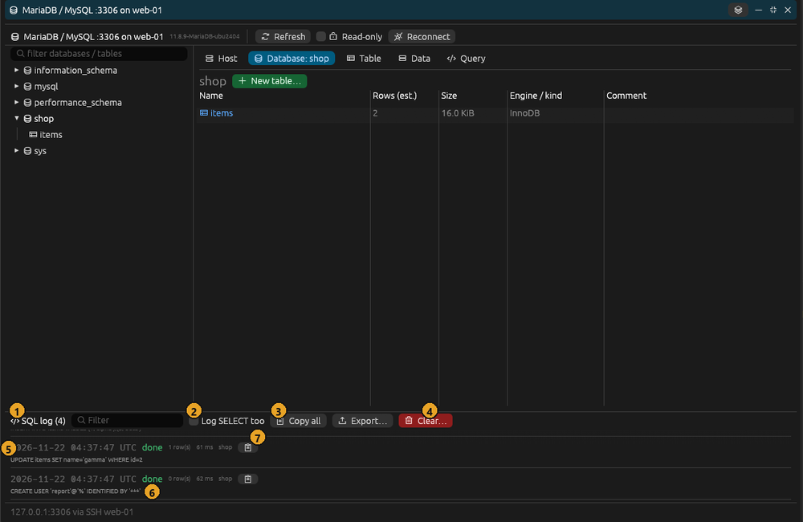

1. **SQL log (_n_)** and its filter.
2. **Log SELECT too**: also log read-only statements of the Query tab.
3. **Copy all** the SQL shown.
4. **Export…** (CSV) and **Clear…**.
5. Time (UTC), result, rows, milliseconds, database.
6. A password in `IDENTIFIED BY` is written as `'***'`.
7. Copy one statement.

Like HeidiSQL, the bottom of a database window is the **SQL log**: every statement this
connection ran that changed data or structure, also from earlier sessions, newest last.

| Logged | Shows |
|---|---|
| Grid **Post** | each UPDATE / INSERT / DELETE with its values written in, rows changed, or **rolled back** with the server's error (the whole post is one transaction) |
| Structure changes | the ALTER / CREATE / DROP / TRUNCATE / RENAME you saw before **Run**, done or failed |
| Query tab | each statement that changes something (UPDATE, INSERT, DELETE, ALTER, CREATE, GRANT, …), rows affected, milliseconds, error. SELECT / SHOW / DESCRIBE / EXPLAIN only with **Log SELECT too** |

Every line has the time (UTC), the database / schema and a copy button; **Filter**,
**Copy all**, **Export…** (CSV) and **Clear…** (asks first; this connection only) are at
the top of the panel. Drag its top edge to make it taller. Passwords in `IDENTIFIED BY`,
`PASSWORD '…'` and `PASSWORD('…')` are written as `'***'`; connection passwords are never
logged. The log is kept in `history.db` with the [transfer history](#transfer-history).

## Fan speeds and BMC temperatures (IPMI)

CPU temperatures work without setup. Fans and inlet/exhaust temperatures on physical
servers come from the BMC through `ipmitool`, which needs root, so each physical host
needs a one-time setup. Open the host and in **Sensors** click **Set up BMC access…**:
a terminal opens on the host showing the exact commands, waits for Enter and lets
sudo ask for your password. By hand (replace `USER` with the login user):

```bash
sudo apt install ipmitool
echo 'USER ALL=(root) NOPASSWD: /usr/bin/ipmitool sdr type Fan, /usr/bin/ipmitool sdr type Temperature' | sudo tee /etc/sudoers.d/telepad-ipmi
sudo chmod 440 /etc/sudoers.d/telepad-ipmi && sudo visudo -c
```

The rule allows only those two read-only commands. This is the only change Telepad ever
offers to make on a host, and only in a terminal you opened yourself. Virtual machines
have no BMC; the Sensors section says which step is missing on a host that has one.

## Updates

Telepad checks the latest [GitHub release](https://github.com/yohannaftali/telepad/releases)
at start and every 6 hours, in the background, over HTTPS (no account or token). It reads
github.com's normal release pages, not the GitHub API, so an office where many people
share one internet address does not run into GitHub's API limit. If a check fails, it is
tried again after 30 minutes and the reason shows in **Software update…**.

1. When a newer version exists, the top bar shows **Update X available**.
2. Click it (or **☰ → Software update…**) to see the version and a link to the
   release notes.
3. **Update now** downloads the zip for your platform, verifies it against the release's
   `.sha256` and replaces `telepad.exe` and `telepad-check.exe`. If anything fails,
   nothing is replaced.
4. **Restart now** (or **Restart for X** in the top bar) starts the new version.

**Later** hides the button until the next start; **Check now** checks immediately.
Your `telepad.db`, `config` and `.env` are never touched. Under **Update source** you
can turn the checks off or point them at a fork's repository.

**Install automatically** (under **Update source**, off by default) skips steps 1–3:
when a check finds a newer version, Telepad downloads it, verifies the `.sha256` and
installs it in the background. Nothing restarts by itself: the top bar shows
**Restart for X**, or the new version starts the next time you open Telepad. **Later**
also pauses automatic installs until the next start.

## Troubleshooting

| Message | What to check |
|---|---|
| `authentication failed` | The key is not accepted or the host wants a password. Try `ssh <alias>` in a terminal; check IdentityFile and the server's `authorized_keys`. A key with a passphrase must be loaded in the ssh agent first (macOS: `ssh-add --apple-use-keychain ~/.ssh/id_ed25519`). |
| `private key … is readable by other users` | ssh ignores private keys that others can read (common after copying keys from another computer). Run the `chmod 600 <key>` shown in the message, and `chmod 700 ~/.ssh`. |
| `host key mismatch` | The host's key changed. Verify why, then remove the old line from `~/.ssh/known_hosts`. |
| `connection timed out` + `(no ping reply, SSH port 22 closed)` | The host is down or unreachable from your network (VPN?). It is checked every round and read again as soon as it answers. |
| `connection timed out` + `(no ping reply, SSH port 22 open)` | The machine is up and only drops ping; the SSH timeout was passing (busy host, slow network). It is tried again on the next round. |
| `not reachable: no ping reply, SSH port 22 closed` | The host was down at the last attempt and still is; SSH is skipped until it answers ping or its SSH port opens. |
| `connection timed out` + `(host answers ping …)` | The machine is up but SSH is blocked or not running. |
| `no common SSH algorithm (legacy host)` | Add e.g. `KexAlgorithms +diffie-hellman-group1-sha1` under **Other ssh options**. |
| Sensors: `ipmitool not installed` / `sudo rule missing` | Use **Set up BMC access…** on that host. |
| Update check: `cannot reach GitHub` | No internet or a proxy blocks `api.github.com`; Telepad keeps working without updates. |

## Command line

```powershell
telepad.exe                              # GUI
telepad.exe --db D:\other\telepad.db     # use another database
telepad.exe --config D:\ssh\config       # import from this config on first start
telepad.exe --prefs D:\other\preference.db  # workspaces from another file
telepad.exe --history D:\other\history.db   # transfer history and SQL log elsewhere
telepad.exe --update-db D:\other\update.db  # Update Strategy and last known info elsewhere
telepad-check.exe                        # check all monitored hosts once, text
telepad-check.exe web01 nas01 --json     # selected hosts, JSON
telepad-check.exe --check-update         # newer release on GitHub?
telepad-check.exe --logins web01         # SSH logins from the host's journal (Log info)
telepad-check.exe --local [--json]       # this computer, as My Computer reads it
```

`telepad-check` exits 0 when every host answered and non-zero otherwise, so it fits in
scripts and scheduled tasks. `--check-update` exits 0 when up to date, 10 when an update
is available and 2 when the check failed.

| Setting | Where |
|---|---|
| Database | `--db <path>`, `TELEPAD_DB`, else `telepad.db` next to `config`, else next to the exe for a portable copy (`portable` file or an existing `telepad.db` there), else the per-user data folder: `%APPDATA%\Telepad`, `~/Library/Application Support/Telepad`, `~/.local/share/telepad` |
| First-run import | `--config <path>`, `TELEPAD_CONFIG`, `./config`, `config` next to the exe, or `config` in the data folder; only read while the database is empty |
| Generated ssh config | `telepad.ssh_config` next to the database (do not edit: rewritten on every change) |
| Workspaces | `--prefs <path>`, `TELEPAD_PREFS`, else `preference.db` next to the database |
| Transfer history and SQL log | `--history <path>`, `TELEPAD_HISTORY`, else `history.db` next to the database (90 days, 50 000 lines) |
| Update Strategy and last known info | `--update-db <path>`, `TELEPAD_UPDATE_DB`, else `update.db` next to the database |
| Fallback key for hosts without IdentityFile | `SSH_IDENTITY_FILE=` in a `.env` file next to `config` |
| ssh binary | `TELEPAD_SSH` (default: Windows `System32\OpenSSH\ssh.exe`, else `ssh` on `PATH`) |

Security model: see [SECURITY.md](../SECURITY.md).
